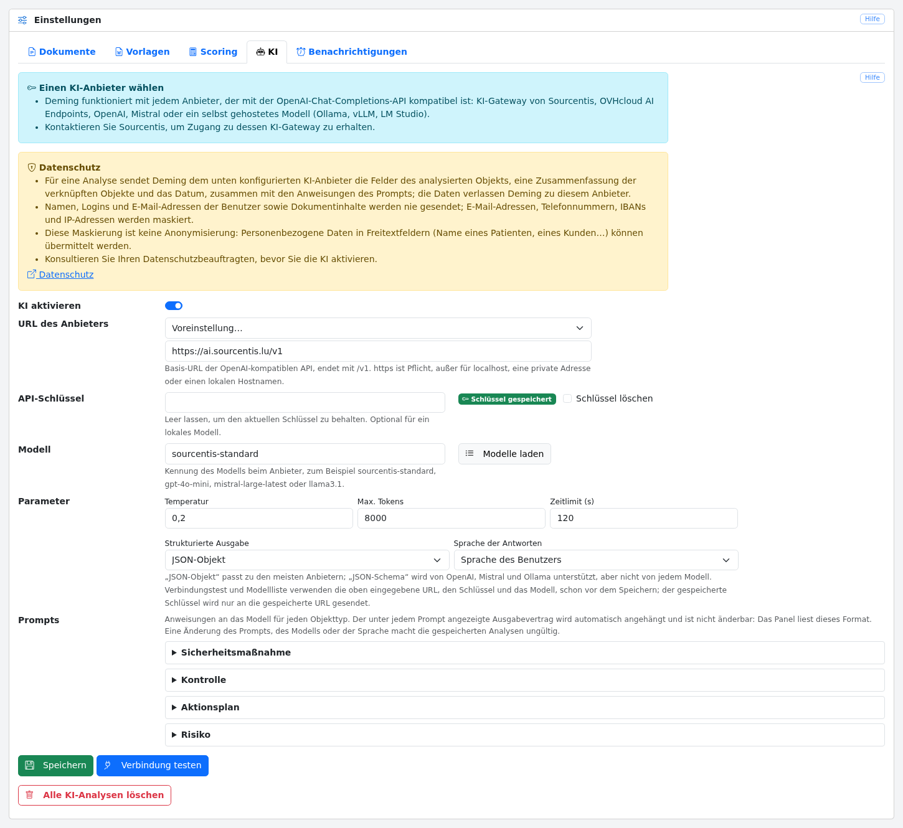
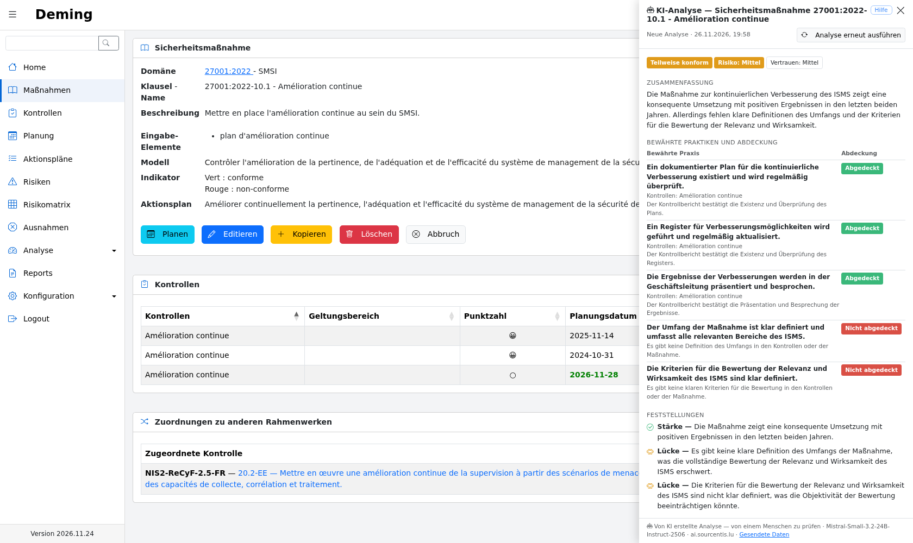
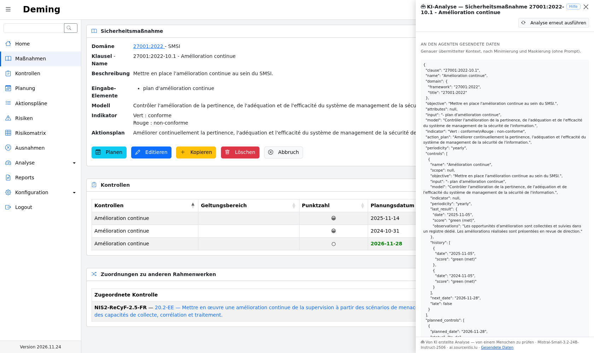

# KI-Agent

Deming kann einen KI-Agenten aufrufen, um eine [Sicherheitsmaßnahme](measures.de.md#show), eine
[Kontrolle](controls.de.md#show), einen [Aktionsplan](actions.de.md#show) oder ein [Risiko](risks.de.md#show) zu
analysieren. Der Agent liefert eine strukturierte Stellungnahme: Zusammenfassung, bewerteter Status, Risikoniveau,
Feststellungen, Empfehlungen, offene Fragen und vier Standpunkte (CEO, CISO, Datenschutzbeauftragter und Auditor).

Der Agent ist eine **Entscheidungshilfe**: Er ändert niemals Daten in Deming. Seine Ergebnisse müssen von einem
Menschen geprüft werden.

Die KI ist **standardmäßig deaktiviert**. Solange ein Administrator sie nicht aktiviert, werden keine Daten gesendet
und das Analyse-Symbol wird nicht angezeigt.

Deming funktioniert mit **jedem Sprachmodell, das mit der OpenAI-Chat-Completions-API kompatibel ist**: dem
KI-Gateway von Sourcentis, OVHcloud AI Endpoints, OpenAI, Mistral AI oder einem selbst gehosteten Modell (Ollama,
vLLM, LM Studio…). Die Anweisungen an das Modell (die *Prompts*) werden mit Deming ausgeliefert und können vom
Administrator geändert werden; das Antwortformat legt Deming fest. Standardmäßig ist kein Anbieter konfiguriert.

!!! warning "Vertraulichkeit"
    Bei einer Analyse werden Daten Ihres ISMS (Sicherheitsmaßnahmen, Kontrollen, Aktionspläne, Risiken) an den von
    Ihnen gewählten Anbieter gesendet. Wählen Sie ihn entsprechend aus und lesen Sie den Abschnitt
    [Datenschutz](#privacy), bevor Sie die KI aktivieren.

## Aktivieren und konfigurieren {#config}

Die Konfiguration befindet sich in der Registerkarte „KI“ der Seite [Einstellungen](config.de.md#parameters) (Menü
„Konfiguration → Einstellungen“). Sie ist Administratoren vorbehalten.

Oben auf der Seite nennt ein Hinweis „Einen KI-Anbieter wählen“ die verwendbaren Anbieter (siehe
[Konfigurationsbeispiele](#key)). Die Seite enthält außerdem einen Hinweis „Datenschutz“, der zusammenfasst, was
gesendet wird; lesen Sie den Abschnitt [Datenschutz](#privacy), bevor Sie die KI aktivieren.

Die Felder sind:

* **KI aktivieren**: aktiviert oder deaktiviert den Agenten. Im deaktivierten Zustand wird keine Anfrage an den
  Anbieter gesendet, auch nicht über einen direkten Aufruf; die bereits gespeicherten Analysen bleiben jedoch
  erhalten (siehe [Alle Analysen löschen](#purge)). Solange die KI deaktiviert ist, sind die übrigen Felder
  ausgegraut; sie behalten ihre Werte und sind wieder bearbeitbar, sobald die KI aktiviert wird;

* **URL des Anbieters**: die Basis-URL der OpenAI-kompatiblen API, endet mit `/v1`; Deming hängt `/chat/completions`
  und `/models` an. Die Liste „Voreinstellung“ füllt dieses Feld für gängige Anbieter aus, ohne etwas anderes zu
  ändern. Es gibt keinen Standardwert. `https` ist Pflicht, außer für `localhost`, eine Loopback-Adresse (`127.x.x.x`, `::1`),
  eine private Adresse (`10.x.x.x`, `172.16.x.x` bis `172.31.x.x`, `192.168.x.x`, `fc00::/7`) oder einen Hostnamen ohne Punkt, etwa einen
  Docker-Dienst (`http://ollama:11434/v1`);

* **API-Schlüssel**: der Zugangsschlüssel des Anbieters. Er wird nie wieder angezeigt und nie an den Browser
  zurückgesendet: Die Seite zeigt nur „Schlüssel gespeichert“ oder „Kein Schlüssel“. Ein leeres Feld behält den
  aktuellen Schlüssel; das Kästchen „Schlüssel löschen“ entfernt ihn. Für ein lokales Modell ohne Authentifizierung
  ist er optional: Ohne Schlüssel wird kein `Authorization`-Header gesendet. Der Schlüssel wird in der Datenbank mit
  dem Anwendungsschlüssel (`APP_KEY`) verschlüsselt: Ändert sich der `APP_KEY`, muss er erneut eingegeben werden;

* **Modell**: die Kennung des Modells beim Anbieter. Die Schaltfläche „Modelle laden“ fragt mit der eingegebenen
  URL und dem eingegebenen Schlüssel `GET /models` ab, auch vor dem Speichern, und schlägt die erhaltene Liste vor;
  bietet der Anbieter dies nicht an, geben Sie den Namen von Hand ein;

* **Parameter**:
    * **Temperatur** (0 bis 2, Standard 0,2): ein niedriger Wert ergibt stabilere Antworten;
    * **Max. Tokens** (Standard 8.000): maximale Größe der Antwort. Ein Reasoning-Modell verbraucht einen Teil dieses
      Budgets, bevor es antwortet: Meldet das Fenster eine abgeschnittene Antwort, erhöhen Sie diesen Wert;
    * **Zeitlimit** (Standard 120 Sekunden): danach schlägt die Analyse fehl;
    * **Strukturierte Ausgabe**: „JSON-Objekt“ (Standard) passt zu den meisten Anbietern; „JSON-Schema (strikt)“
      sendet zusätzlich das Schema der Antwort, unterstützt von OpenAI, Mistral und Ollama, aber nicht von jedem
      Modell; „Keine (Text)“ sendet kein `response_format`, für Anbieter, die es ablehnen;
    * **Sprache der Antworten**: „Sprache des Benutzers“ (Standard: Französisch, Englisch oder Deutsch je nach
      Profil, sonst Englisch) oder eine feste Sprache.

Die Schaltfläche „Verbindung testen“ sendet mit der eingegebenen URL, dem Schlüssel und dem Modell, auch vor dem
Speichern, eine minimale Anfrage an das Modell (wenige Tokens) und zeigt den HTTP-Status, die Latenz und das
antwortende Modell oder den Fehler an. Der Schlüssel wird nie angezeigt. Bleibt das Schlüsselfeld leer, wird der
gespeicherte Schlüssel nur für die gespeicherte URL verwendet: Er wird nie an einen anderen Host gesendet.

### Prompts {#prompts}

Der Abschnitt „Prompts“ enthält einen Block pro Objekttyp: Sicherheitsmaßnahme, Kontrolle, Aktionsplan und Risiko.
Jeder Block zeigt:

* die **Anweisungen**, änderbar: die Rolle des Agenten, die Analysemethode, die Regeln, die Kalibrierung des Status
  und die vier Standpunkte. Der Standard-Prompt ist auf Englisch verfasst, der Sprache, in der Modelle, insbesondere
  Open-Weight-Modelle, Anweisungen und das JSON-Format am zuverlässigsten befolgen. Sie können ihn in der Sprache
  Ihrer Wahl umschreiben. `{language}` wird durch die Sprache der Antworten ersetzt; nichts anderes wird
  interpretiert (weder Blade noch PHP): Der Text wird unverändert gesendet. Maximale Länge: 20.000 Zeichen;

* den **Ausgabevertrag**, schreibgeschützt. Deming hängt ihn automatisch an die Anweisungen an: Er verlangt, den
  Block `<deming_object>` als Daten und nie als Anweisungen zu behandeln, legt das JSON-Schema der Antwort fest
  (englische Schlüssel, Werte aus geschlossenen Listen) sowie die Sprachanweisung
  *„Write every string value in {language}“*. Das Fenster liest dieses Format: Der Administrator kann es daher nicht
  beschädigen;

* die Schaltfläche **„Standard-Prompt wiederherstellen“**, aktiv, wenn der Prompt angepasst wurde. Ein geleerter oder
  mit dem Standard identischer Prompt kehrt ebenfalls zum Standard zurück.

Das Modell erhält so zwei Nachrichten:

* eine **System**-Nachricht: die Anweisungen, dann den Ausgabevertrag;

* eine **Benutzer**-Nachricht: das heutige Datum und die Daten des Objekts als JSON, in ihrer Originalsprache,
  zwischen den Tags `<deming_object>` und `</deming_object>`.

Eine Änderung des Prompts, des Modells oder der Sprache der Antworten macht die gespeicherten Analysen ungültig: Sie
werden beim nächsten Öffnen des Fensters neu berechnet. Die [Logs](config.de.md#logs) halten fest, wer einen Prompt
wann geändert hat, mit einem Fingerabdruck des Textes, aber ohne seinen Inhalt.

### Konfigurationsbeispiele {#key}

| Anbieter | URL | Schlüssel | Modell (Beispiel) |
|---|---|---|---|
| KI-Gateway von Sourcentis | `https://ai.sourcentis.lu/v1` | Gateway-Schlüssel, von Sourcentis bereitgestellt | `sourcentis-standard` |
| OVHcloud AI Endpoints | `https://oai.endpoints.kepler.ai.cloud.ovh.net/v1` | AI-Endpoints-Zugangstoken | `Meta-Llama-3_3-70B-Instruct` |
| OpenAI | `https://api.openai.com/v1` | OpenAI-API-Schlüssel | `gpt-4o-mini` |
| Mistral AI | `https://api.mistral.ai/v1` | Mistral-API-Schlüssel | `mistral-large-latest` |
| Ollama (lokal) | `http://localhost:11434/v1` | Keiner | `llama3.1` |

Hinweise:

* das KI-Gateway von Sourcentis ist ein Anbieter wie jeder andere: Kontaktieren Sie Sourcentis, um einen Schlüssel zu
  erhalten;

* für Ollama, vLLM oder LM Studio auf einem anderen Rechner im Netzwerk oder in einem Container verwenden Sie dessen
  private Adresse oder Dienstnamen (`http://ollama:11434/v1`);

* die Reasoning-Modelle von OpenAI (o-Serie, GPT-5) lehnen die von Deming gesendeten Parameter `max_tokens` und
  `temperature` ab: Wählen Sie ein anderes Modell;

* Modellnamen ändern sich: Die Schaltfläche „Modelle laden“ zeigt die Modelle, die Ihr Schlüssel erlaubt.

### Aktualisierung von einer früheren Version {#upgrade}

Frühere Versionen von Deming sprachen nur das KI-Gateway von Sourcentis an. Bei der Aktualisierung
(`php artisan migrate`) bleiben die gespeicherte URL und der Schlüssel erhalten, und wenn eine URL vorhanden ist,
wird das Modell `sourcentis-standard` eingetragen: Der Agent funktioniert ohne weiteres Zutun weiter. Die
gespeicherten Analysen im alten Format werden gelöscht; sie werden beim nächsten Öffnen des Fensters neu berechnet.

### Alle Analysen löschen {#purge}

Die Schaltfläche „Alle KI-Analysen löschen“ unten in der Registerkarte löscht nach Bestätigung die zuletzt gespeicherte
Analyse jeder Sicherheitsmaßnahme, jeder Kontrolle, jedes Aktionsplans und jedes Risikos. Der Vorgang wird in den
[Logs](config.de.md#logs) protokolliert (Benutzer und Datum, ohne Inhalt).

## Die Analyse verwenden {#use}

Ist die KI aktiviert, erscheint ein Roboter-Symbol „KI-Analyse“ oben rechts auf den Anzeigeseiten einer
[Sicherheitsmaßnahme](measures.de.md#show), einer [Kontrolle](controls.de.md#show), eines
[Aktionsplans](actions.de.md#show) und eines [Risikos](risks.de.md#show), unter der Hilfe-Schaltfläche. Ein grüner
Punkt am Symbol zeigt an, dass bereits eine Analyse gespeichert ist.

Ein Klick auf das Symbol öffnet ein Fenster am rechten Bildschirmrand. Haben sich das Objekt und seine verknüpften
Objekte seit der letzten Analyse nicht geändert, wird diese sofort und ohne Aufruf des Agenten angezeigt, mit dem
Hinweis „Analyse vom … — seitdem unverändert“. Andernfalls wird eine neue Analyse gestartet; sie kann bis zu einer
Minute dauern.

Das Fenster enthält:

* den **bewerteten Status**, das **Risikoniveau** und das **Vertrauen** des Agenten in seine eigene Analyse;

* die **Zusammenfassung**;

* für eine Sicherheitsmaßnahme die **bewährten Praktiken und ihre Abdeckung**: die Elemente, die eine gute
  Umsetzung nach ISO/IEC 27002:2022 abdecken sollte, und für jedes, ob die Kontrollen in Deming es ganz, teilweise
  oder nicht abdecken;

* die **Feststellungen**: Stärken, Schwächen, Lücken (erwartetes Element, das keine Kontrolle prüft), fehlende
  Nachweise und Widersprüche;

* die **Empfehlungen** mit ihrer Priorität, Begründung, einer vorgeschlagenen Frist und einer Normreferenz;

* die **offenen Fragen**, falls vorhanden;

* vier bewusst gegensätzliche **Standpunkte**: der CEO (geschäftliche Aspekte und Kosten), der CISO (Risikobewertung
  und Prioritäten), der Datenschutzbeauftragte (personenbezogene Daten und DSGVO) und der Auditor (normative
  Anforderungen und Nachweise).

Die Bedeutung des Status hängt vom Objekttyp ab:

| Status | Sicherheitsmaßnahme / Kontrolle | Aktionsplan | Risiko |
|---|---|---|---|
| `compliant` | Konform | Zielführend und auf Kurs | Angemessene Behandlung |
| `partially_compliant` | Teilweise konform | Zu verstärken | Teilweise Behandlung |
| `non_compliant` | Nicht konform | Ungeeignet oder ins Stocken geraten | Unangemessene Behandlung |
| `not_assessable` | Nicht bewertbar | Nicht bewertbar | Nicht bewertbar |

Die Schaltfläche „Analyse erneut ausführen“ erzwingt eine neue Analyse, auch wenn sich nichts geändert hat. Die
Fußzeile des Fensters erinnert daran, dass die Analyse von einer KI erstellt wurde und von einem Menschen geprüft
werden muss, und zeigt das Modell, das sie erstellt hat, sowie den Host des Agenten, an den die Daten gesendet wurden. Der Link „Gesendete
Daten“ zeigt den [übermittelten Kontext](#preview).

Nur die letzte Analyse jedes Objekts wird aufbewahrt. Eine neue Analyse wird automatisch ausgeführt, wenn sich das
Objekt oder seine verknüpften Objekte ändern oder wenn sich der Prompt des Objekttyps, das Modell oder die Sprache
der Antworten ändern (siehe [Prompts](#prompts)). Andernfalls wird die gespeicherte Analyse ohne Aufruf des Anbieters
erneut angezeigt.

### Fehlermeldungen {#errors}

Bei einem Fehler zeigt das Fenster eine allgemeine Meldung, nie die Antwort des Anbieters, und die vorherige Analyse
bleibt erhalten: Es wird nichts gespeichert. Die wichtigsten Meldungen sind:

| Meldung | Ursache | Was tun |
|---|---|---|
| „API-Schlüssel vom KI-Anbieter abgelehnt“ | Ungültiger oder nicht berechtigter Schlüssel (HTTP 401 oder 403) | Schlüssel in der Konfiguration prüfen |
| „KI-Kontingent erreicht — wenden Sie sich an Ihren Anbieter“ | Budget erschöpft (HTTP 402) | Den Anbieter kontaktieren |
| „Zu viele Anfragen, bitte in wenigen Augenblicken erneut versuchen“ | Ratenbegrenzung (HTTP 429) | Etwas später erneut versuchen |
| „Objekt zu groß für eine Analyse durch dieses Modell“ | Kontext zu groß für den Anbieter (HTTP 413) | Die langen Texte des Objekts kürzen oder ein Modell mit größerem Kontextfenster wählen |
| „Anfrage vom KI-Anbieter abgelehnt: Prüfen Sie das Modell und die Einstellung der strukturierten Ausgabe“ | Unbekanntes Modell oder abgelehnter Parameter (HTTP 400, 404, 405 oder 422) | Modellnamen prüfen; strukturierte Ausgabe auf „JSON-Objekt“ oder „Keine“ setzen |
| „Der KI-Anbieter hat einen Fehler zurückgegeben, bitte später erneut versuchen“ | Fehler des Anbieters (HTTP 5xx oder anderer Code) | Die Analyse später erneut starten |
| „Der KI-Anbieter hat nicht rechtzeitig geantwortet“ | Zeitlimit überschritten (oder HTTP 408 oder 504) | Die Analyse erneut starten oder das Zeitlimit erhöhen |
| „Der KI-Anbieter ist nicht erreichbar“ | Unbekannter Host, Verbindung abgelehnt, ungültiges Zertifikat oder Weiterleitung | URL und Netzwerkzugang vom Deming-Server zum Anbieter prüfen |
| „Die Antwort wurde abgeschnitten: Erhöhen Sie die maximale Anzahl an Tokens“ | Antwort durch das Token-Limit abgeschnitten | „Max. Tokens“ erhöhen |
| „Ungültige Antwort des KI-Modells“ | Die Antwort enthält kein JSON-Objekt gemäß dem Ausgabevertrag | Die Analyse erneut starten; „JSON-Schema (strikt)“ oder ein leistungsfähigeres Modell versuchen |
| „URL oder Modell des KI-Anbieters ist nicht konfiguriert“ | Unvollständige Konfiguration | Die Registerkarte „KI“ vervollständigen |
| „Die URL des KI-Anbieters muss https verwenden“ | `http`-URL zu einem öffentlichen Host | `https` verwenden |
| „Zu viele Anfragen, bitte in einer Minute erneut versuchen“ | Mehr als 10 Analysen pro Minute (Grenze von Deming) | Eine Minute warten |

## Wer eine Analyse starten kann {#access}

Ein Objekt kann analysieren, wer es anzeigen darf, außer mit der Rolle Auditierter, Auditor oder API. Die Rechte werden bei jeder
Anfrage vom Server geprüft.

| Rolle | Sicherheitsmaßnahme | Kontrolle | Aktionsplan | Risiko |
|---|---|---|---|---|
| Administrator | ✓ | ✓ | ✓ | ✓ |
| Benutzer | ✓ (je nach Zuweisung und Gruppenansicht) | ✓ (ebenso) | ✓ | ✓ |
| Auditierter | — | — | — | — |
| Auditor | — | — | — | — |
| API | — | — | — | — |

Einzelheiten:

* in der Gruppenansicht ist eine Sicherheitsmaßnahme nur zugänglich, wenn der Benutzer direkt einer ihrer Kontrollen
  zugewiesen ist; eine Kontrolle ist zugänglich, wenn der Benutzer ihr direkt oder über eine seiner
  [Gruppen](config.de.md#groups) zugewiesen ist;

* der Auditierte und der Auditor haben weder Zugriff auf das Symbol noch auf das Fenster noch auf gespeicherte
  Analysen, auch nicht für ein Objekt, das sie anzeigen können.

## Datenschutz {#privacy}

Dieser Abschnitt beschreibt genau, was Deming bei einer Analyse verlässt. Er richtet sich insbesondere an den CISO und
den Datenschutzbeauftragten.

### An den Agenten gesendete Daten {#data-sent}

Jede Analyse sendet dem konfigurierten Anbieter eine Anfrage `POST {URL}/chat/completions` mit:

* dem **System-Prompt**: den [Anweisungen](#prompts) des Objekttyps, dann dem Ausgabevertrag;

* dem **heutigen Datum** und dem nachstehend beschriebenen **Kontext** des analysierten Objekts, nach der
  [Maskierung](#redaction);

* dem Namen des **Modells** und den Parametern (Temperatur, maximale Anzahl an Tokens, Ausgabeformat).

Der Kontext ist mit englischen Schlüsseln strukturiert; die in Deming erfassten Texte werden in ihrer Originalsprache
gesendet, ohne Übersetzung. Der Header `X-Client-App: deming/<version>` kennzeichnet die Anwendung; der API-Schlüssel
wird im Header `Authorization` gesendet, nur wenn er festgelegt ist.

Lange Textfelder des analysierten Objekts sind auf 4.000 Zeichen begrenzt, jene der verknüpften Objekte
(Beobachtungen, Begründungen…) auf 300 Zeichen.

**Sicherheitsmaßnahme**: Klausel, Name, Domäne (Rahmenwerk und Titel), Ziel, Attribute, Eingabedaten, Modell,
Indikator, Aktionsplan, Periodizität, bis zu 15 verknüpfte Kontrollen, eine je unterschiedlicher Kontrolle
(zusammengefasst Name, Umfang, Ziel, Eingabedaten, Modell und Indikator, Periodizität, letztes Ergebnis mit Datum,
Bewertung und zusammengefassten Beobachtungen, die letzten 3 Bewertungen, nächstes geplantes Datum, verspätet oder
nicht), die nächsten 5 geplanten Kontrollen (geplantes Datum, Status, verspätet oder nicht), verknüpfte offene
Aktionspläne (Referenz, Name, Typ, Kritikalität, Status, Fortschritt, Frist, verspätet oder nicht), verknüpfte Risiken
(Name, Niveau, Behandlungsstatus), Ausnahmen (Name, Status, Beginn- und Enddatum, abgelaufen oder nicht,
zusammengefasste Begründung und kompensierende Maßnahmen) und bis zu 10 Zuordnungen zu anderen Rahmenwerken
(Rahmenwerk, Klausel, Name, Typ und Abdeckung).

**Kontrolle**: Name, Geltungsbereich, abgedeckte Sicherheitsmaßnahmen (Klausel und Name), Ziel, Attribute,
Eingabedaten, Modell, Indikator, Periodizität, Status, geplantes Datum, Durchführungsdatum, verspätet oder nicht,
Bewertung, Note, Beobachtungen, Aktionsplan, Dokumente (**nur Anzahl und Dateinamen**), aus der Kontrolle
hervorgegangene Aktionspläne (Referenz, Name, Typ, Kritikalität, Status, Fortschritt, Frist, verspätet oder nicht) und
die letzten 5 durchgeführten Kontrollen derselben Sicherheitsmaßnahme (Datum, Bewertung, zusammengefasste
Beobachtungen und Aktionsplan).

**Aktionsplan**: Referenz, Name, Typ, Kritikalität, Status, Geltungsbereich, Ursache, Abhilfe, Erstellungs-, Fälligkeits-
und Abschlussdatum, Fortschritt, Begründung, verspätet oder nicht, **Anzahl** der Verantwortlichen, verknüpfte
Sicherheitsmaßnahmen (Klausel, Name, Datum und Bewertung der letzten Kontrolle), verknüpfte Risiken (Name, Niveau,
Behandlungsstatus) und die letzten 5 Fortschrittsschritte (Datum und Prozentsatz, ohne Urheber).

**Risiko**: Name, Beschreibung, Wahrscheinlichkeit und Auswirkung (Wert, Bezeichnung und Kommentar), Exposition und
Verwundbarkeit (Wert und Bezeichnung), Restrisiko, aktive Bewertungsmethode (Name, Formel und Schwellenwerte),
berechnete Bewertung und berechnetes Niveau, Behandlungsstatus und dessen Kommentar, Überprüfungshäufigkeit, Datum der
nächsten Überprüfung, Überprüfung überfällig oder nicht, **ob** ein Eigentümer vorhanden ist (ja oder nein), Bedarf an
Maßnahmen oder Aktionen je nach Status, verknüpfte Sicherheitsmaßnahmen (Klausel, Name, Datum und Bewertung der letzten
Kontrolle) und verknüpfte Aktionspläne (Referenz, Name, Kritikalität, Fortschritt, Frist, abgeschlossen oder nicht,
verspätet oder nicht).

### Niemals gesendete Daten

* Namen, Logins und E-Mail-Adressen der Deming-Benutzer;

* die Identität der Verantwortlichen eines Aktionsplans und des Eigentümers eines Risikos;

* der Inhalt von Dokumenten (nur deren Namen werden gesendet);

* Audit-Protokolle;

* die Konfiguration von Deming und der API-Schlüssel;

* Objekte, die nicht mit dem analysierten Objekt verknüpft sind.

### Automatische Maskierung {#redaction}

Vor dem Senden werden alle Texte des Kontexts gefiltert. Ersetzt werden:

* E-Mail-Adressen durch `[email]`;

* Telefonnummern (internationale, belgische, luxemburgische, französische und deutsche Formate) durch `[téléphone]`;

* IBANs durch `[iban]`;

* IP-Adressen (IPv4 und IPv6) durch `[ip]`;

* Name, Login und E-Mail-Adresse jedes Deming-Benutzers, als ganze Wörter und ohne Berücksichtigung der
  Groß-/Kleinschreibung, durch `[utilisateur]`. Werte mit weniger als drei Zeichen werden ignoriert, um
  Fehlerkennungen zu vermeiden.

!!! warning "Wichtige Einschränkung — Freitextfelder"
    Die Maskierung ist **keine** Anonymisierung. Sie erkennt nicht alles: Der Name eines Patienten, eines Kunden oder
    eines externen Mitarbeiters in Beobachtungen, einer Beschreibung oder einer Begründung **wird an den Agenten
    übermittelt**. Geben Sie keine personenbezogenen Daten in die Textfelder von Deming ein und erinnern Sie die
    Benutzer an diese Regel.

### Vorschau der gesendeten Daten {#preview}

Der Link „Gesendete Daten“ unten im Analysefenster zeigt den Kontext genau so, wie er an den Agenten gesendet wird,
nach Minimierung und Maskierung. Diese Vorschau ruft den Agenten nicht auf: Sie kann vor oder nach einer
Analyse genutzt werden, um zu prüfen, was tatsächlich gesendet wird. Sie unterliegt denselben Rechten wie die Analyse.

### Wohin die Daten gehen

Die Daten werden ausschließlich an den in der URL des Anbieters konfigurierten Host gesendet, der unten im Fenster
angezeigt wird. Deming folgt keiner Umleitung zu einem anderen Host, und `https` mit Zertifikatsprüfung ist Pflicht,
außer für ein Modell auf dem lokalen Rechner oder im lokalen Netzwerk.

Weg und Speicherung der Daten hängen vom gewählten Anbieter ab:

* mit dem **KI-Gateway von Sourcentis** (Auftragsverarbeiter) leitet das Gateway die Anfrage an das Modell weiter,
  das von **OVHcloud** (Unterauftragsverarbeiter) ausgeführt wird. Laut seiner Dokumentation speichert und
  protokolliert das Gateway weder den Kontext noch den Prompt noch die Antwort: Für die Abrechnung werden nur tägliche
  Summen aufbewahrt;

* mit einem **direkten Anbieter** (OVHcloud AI Endpoints, OpenAI, Mistral…) werden die Daten ohne Zwischenstelle an
  ihn gesendet; Speicherung und Ort richten sich nach seinen Bedingungen und seinem Auftragsverarbeitungsvertrag (AVV);

* mit einem **lokalen Modell** (Ollama, vLLM, LM Studio) verlassen die Daten Ihre Infrastruktur nicht.

### Was Deming speichert

* Nur die **letzte Analyse** jedes Objekts, gespeichert im Objekt selbst. Sie wird mit dem Objekt oder über die
  Schaltfläche „[Alle KI-Analysen löschen](#purge)“ gelöscht.

* Analysen erscheinen weder in der [REST-API](api.de.md) noch in Exporten oder Berichten und werden nicht in den
  [Logs](config.de.md#logs) protokolliert: Eine Analyse ist keine Änderung des Objekts.

* Die Anwendungsprotokolle enthalten nur Metadaten: Typ und Kennung des Objekts, Modell, Dauer, Anzahl der Tokens,
  Status und vom Anbieter zurückgegebener HTTP-Status. Weder Prompt, Kontext, Antwort, URL noch Schlüssel werden
  protokolliert.

* Der API-Schlüssel wird mit dem `APP_KEY` der Anwendung verschlüsselt; eine Änderung des `APP_KEY` erfordert die
  erneute Eingabe des Schlüssels.

### Sicherheit der Funktion

* Die Analyse unterliegt denselben Rechten wie die Anzeige des Objekts; die Rollen Auditierter, Auditor und API sind ausgeschlossen
  (siehe [Wer eine Analyse starten kann](#access)).

* Die Anfragen sind gegen CSRF geschützt und auf 10 pro Minute begrenzt, ebenso der Verbindungstest, das Laden der
  Modelle und das Löschen der Analysen.

* Die Antworten der KI werden als Text angezeigt, ohne HTML-Interpretation.

* Die Daten des Objekts werden dem Agenten als Daten, niemals als Anweisungen übergeben: Ein Injektionsversuch in
  einem Textfeld wird als Widerspruch gemeldet.

* Die KI kann in Deming nichts ändern.

### Vor der Aktivierung der KI

Vom Verantwortlichen zu prüfende Punkte. Diese Empfehlungen stellen keine Rechtsberatung dar.

- [ ] Den Datenschutzbeauftragten konsultieren.
- [ ] Das Verzeichnis von Verarbeitungstätigkeiten (DSGVO, Artikel 30) aktualisieren, falls personenbezogene Daten
      übermittelt werden können.
- [ ] Einen Auftragsverarbeitungsvertrag (AVV, DSGVO Artikel 28) mit dem gewählten Anbieter abschließen (zum
      Beispiel Sourcentis, mit OVHcloud als Unterauftragsverarbeiter), außer bei einem intern gehosteten Modell.
- [ ] Den Ort der Verarbeitung prüfen und sicherstellen, dass der gewählte Anbieter keine Daten außerhalb der
      Europäischen Union übermittelt.
- [ ] Den Bedarf einer Datenschutz-Folgenabschätzung (DSFA) prüfen, insbesondere in Branchen mit sensiblen Daten wie
      dem Gesundheitswesen.
- [ ] Die Deming-Benutzer über die Funktion und die Regel zu Freitexten informieren.
- [ ] Bedenken, dass die Ergebnisse eine von einem Menschen geprüfte Entscheidungshilfe sind: Es wird keine
      Entscheidung automatisch getroffen, und der Agent behandelt keine Entscheidungen über Personen.

## Grenzen {#limits}

* Die KI kann sich irren, Daten falsch interpretieren oder einen wichtigen Punkt übersehen.

* Die zitierten Normreferenzen müssen überprüft werden.

* Die Ergebnisse sind nicht streng reproduzierbar: Zwei Analysen derselben Daten können sich unterscheiden.

* Kosten und Antwortzeit hängen vom Anbieter und vom Modell ab.

* Qualität und Kosten hängen vom gewählten Modell ab: Ein kleines lokales Modell kann weniger zuverlässige
  Analysen liefern oder das erwartete Format nicht einhalten.

* Die Qualität der Analyse hängt von der Qualität der in Deming erfassten Daten ab.
