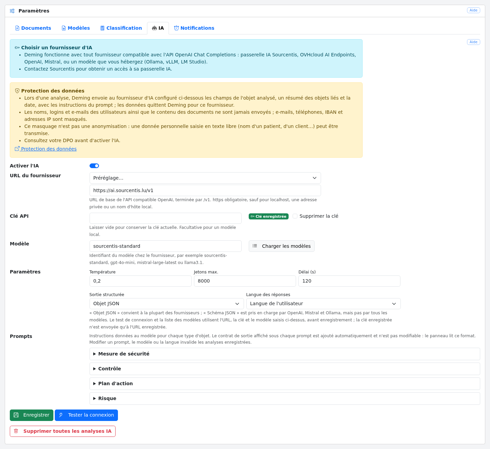
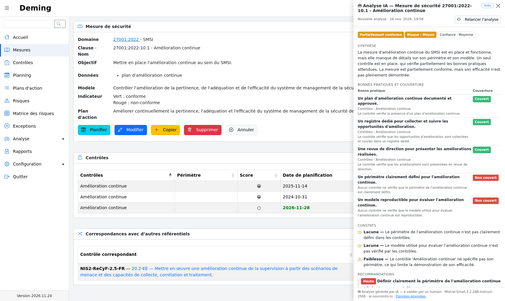
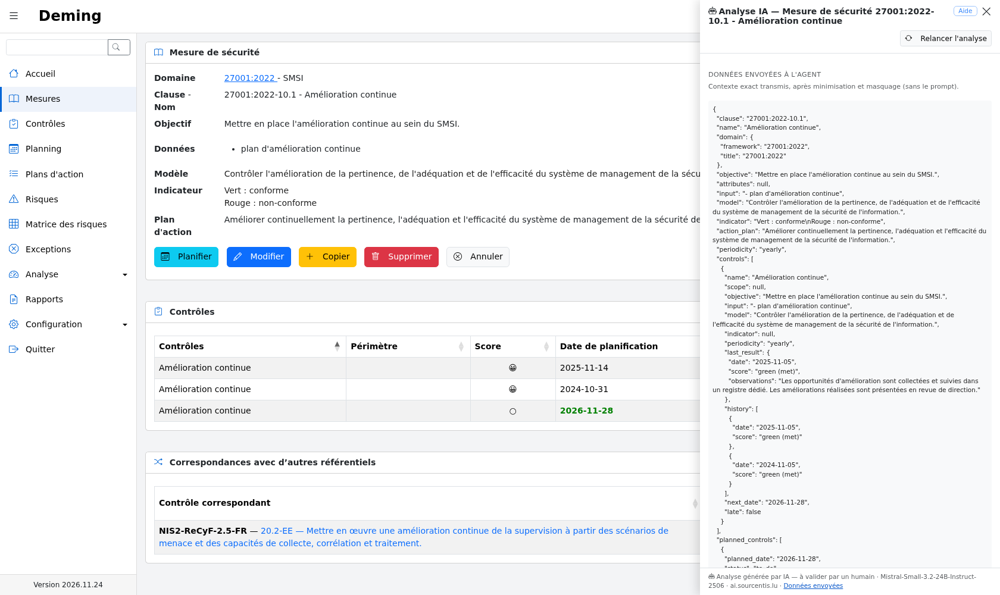

# Agent IA

Deming peut faire appel à un agent d'intelligence artificielle pour analyser une
[mesure de sécurité](measures.fr.md#show), un [contrôle](controls.fr.md#show), un
[plan d'action](actions.fr.md#show) ou un [risque](risks.fr.md#show). L'agent renvoie un avis structuré :
synthèse, statut évalué, niveau de risque, constats, recommandations, questions ouvertes et quatre points de vue
(CEO, RSSI, DPO et auditeur).

L'agent est une **aide à la décision** : il ne modifie jamais les données de Deming. Ses résultats doivent être
validés par un humain.

L'IA est **désactivée par défaut**. Tant qu'elle n'est pas activée par un administrateur, aucune donnée n'est
envoyée et l'icône d'analyse n'apparaît pas.

Deming s'adresse à **n'importe quel modèle de langage compatible avec l'API OpenAI Chat Completions** : la passerelle
IA Sourcentis, OVHcloud AI Endpoints, OpenAI, Mistral AI, ou un modèle que vous hébergez (Ollama, vLLM, LM Studio…).
Les instructions données au modèle (les *prompts*) sont livrées avec Deming et modifiables par l'administrateur ; le
format de la réponse est fixé par Deming. Aucun fournisseur n'est configuré par défaut.

!!! warning "Confidentialité"
    Lors d'une analyse, des données de votre SMSI (mesures de sécurité, contrôles, plans d'action, risques) sont
    envoyées au fournisseur que vous avez choisi. Choisissez-le en conséquence et lisez la section
    [Protection des données](#privacy) avant d'activer l'IA.

## Activer et configurer {#config}

La configuration se trouve dans l'onglet « IA » de la page [Paramètres](config.fr.md#parameters) (menu « Configuration →
Paramètres »). Elle est réservée aux administrateurs.

En haut de l'écran, un encart « Choisir un fournisseur d'IA » rappelle les fournisseurs utilisables (voir
[Exemples de configuration](#key)). L'écran contient aussi un encart « Protection des données » qui rappelle ce qui
est envoyé ; lisez la section [Protection des données](#privacy) avant d'activer l'IA.

Les champs sont les suivants :

* **Activer l'IA** : active ou désactive l'agent. Désactivée, aucune requête ne part vers le fournisseur, y compris
  par un appel direct, mais les analyses déjà enregistrées sont conservées (voir
  [Supprimer toutes les analyses](#purge)). Tant que l'IA est désactivée, les autres champs sont grisés ; ils
  conservent leurs valeurs et redeviennent modifiables dès que l'IA est activée ;

* **URL du fournisseur** : l'URL de base de l'API compatible OpenAI, terminée par `/v1` ; Deming y ajoute
  `/chat/completions` et `/models`. La liste « Préréglage » remplit ce champ pour les fournisseurs courants, sans rien
  changer d'autre. Il n'y a pas de valeur par défaut. Le protocole `https` est obligatoire, sauf pour `localhost`,
  une adresse de bouclage (`127.x.x.x`, `::1`), une adresse privée (`10.x.x.x`, `172.16.x.x` à `172.31.x.x`,
  `192.168.x.x`, `fc00::/7`) ou un nom d'hôte sans
  point, comme un service Docker (`http://ollama:11434/v1`) ;

* **Clé API** : la clé d'accès du fournisseur. Elle n'est jamais réaffichée ni renvoyée au navigateur : l'écran
  indique seulement « Clé enregistrée » ou « Aucune clé ». Laisser le champ vide conserve la clé actuelle ; la case
  « Supprimer la clé » la retire. Elle est facultative pour un modèle local sans authentification : sans clé, aucun
  en-tête `Authorization` n'est envoyé. La clé est chiffrée en base de données avec la clé de l'application
  (`APP_KEY`) : si l'`APP_KEY` change, il faut la ressaisir ;

* **Modèle** : l'identifiant du modèle chez le fournisseur. Le bouton « Charger les modèles » interroge
  `GET /models` avec l'URL et la clé saisies, même avant l'enregistrement, et affiche la liste obtenue dans une liste déroulante sous le champ : choisir un modèle remplit le champ ; si le
  fournisseur ne l'offre pas, saisissez le nom à la main ;

* **Paramètres** :
    * **Température** (de 0 à 2, 0,2 par défaut) : une valeur basse donne des réponses plus stables ;
    * **Jetons max.** (8 000 par défaut) : taille maximale de la réponse. Un modèle de raisonnement consomme une
      partie de ce budget avant de répondre : si le panneau signale une réponse tronquée, augmentez cette valeur ;
    * **Délai** (120 secondes par défaut) : au-delà, l'analyse échoue ;
    * **Sortie structurée** : « Objet JSON » (par défaut) convient à la plupart des fournisseurs ; « Schéma JSON
      (strict) » transmet en plus le schéma de la réponse, pris en charge par OpenAI, Mistral et Ollama mais pas par
      tous les modèles ; « Aucune (texte) » n'envoie pas de `response_format`, pour les fournisseurs qui le refusent ;
    * **Langue des réponses** : « Langue de l'utilisateur » (par défaut : français, anglais ou allemand selon son
      profil, anglais sinon), ou une langue fixe.

Le bouton « Tester la connexion » envoie au modèle une requête minimale (quelques jetons), avec l'URL, la clé et le
modèle saisis, même avant l'enregistrement, et affiche le statut HTTP, la latence et le modèle qui a répondu, ou
l'erreur. La clé n'est jamais affichée. Si le champ de la clé est laissé vide, la clé enregistrée n'est utilisée que
si l'URL est celle enregistrée : elle n'est jamais envoyée à un autre hôte.

### Prompts {#prompts}

La section « Prompts » contient un bloc par type d'objet : mesure de sécurité, contrôle, plan d'action et risque.
Chaque bloc affiche :

* les **instructions**, modifiables : le rôle de l'agent, la méthode d'analyse, les règles, le calibrage du statut et
  les quatre points de vue. Le prompt par défaut est rédigé en anglais, langue dans laquelle les modèles, en
  particulier les modèles open-weight, suivent le plus fidèlement les consignes et le format JSON. Vous pouvez le
  réécrire dans la langue de votre choix. `{language}` est remplacé par la langue des réponses ; rien d'autre n'est
  interprété (ni Blade, ni PHP) : le texte est envoyé tel quel. Longueur maximale : 20 000 caractères ;

* le **contrat de sortie**, en lecture seule. Deming l'ajoute automatiquement après les instructions : il demande de
  traiter le bloc `<deming_object>` comme des données et jamais comme des instructions, fixe le schéma JSON de la
  réponse (clés en anglais, valeurs à liste fermée) et la consigne de langue
  *« Write every string value in {language} »*. Le panneau lit ce format : l'administrateur ne peut donc pas le
  casser ;

* le bouton **« Réinitialiser le prompt par défaut »**, actif lorsque le prompt a été personnalisé. Un prompt vidé ou
  identique au prompt par défaut revient aussi au prompt par défaut.

Le modèle reçoit ainsi deux messages :

* un message **système** : les instructions, puis le contrat de sortie ;

* un message **utilisateur** : la date du jour et les données de l'objet en JSON, dans leur langue d'origine, entre
  les balises `<deming_object>` et `</deming_object>`.

Modifier un prompt, le modèle ou la langue des réponses invalide les analyses enregistrées : elles sont recalculées à
la prochaine ouverture du panneau. Les [logs](config.fr.md#logs) indiquent qui a modifié un prompt et quand, avec une
empreinte du texte mais sans son contenu.

### Exemples de configuration {#key}

| Fournisseur | URL | Clé | Modèle (exemple) |
|---|---|---|---|
| Passerelle IA Sourcentis | `https://ai.sourcentis.lu/v1` | Clé de la passerelle, fournie par Sourcentis | `sourcentis-standard` |
| OVHcloud AI Endpoints | `https://oai.endpoints.kepler.ai.cloud.ovh.net/v1` | Jeton d'accès AI Endpoints | `Meta-Llama-3_3-70B-Instruct` |
| OpenAI | `https://api.openai.com/v1` | Clé API OpenAI | `gpt-4o-mini` |
| Mistral AI | `https://api.mistral.ai/v1` | Clé API Mistral | `mistral-large-latest` |
| Ollama (local) | `http://localhost:11434/v1` | Aucune | `llama3.1` |

Remarques :

* la passerelle IA Sourcentis est un fournisseur comme un autre : contactez Sourcentis pour obtenir une clé ;

* pour Ollama, vLLM ou LM Studio sur une autre machine du réseau ou dans un conteneur, utilisez son adresse privée ou
  son nom de service (`http://ollama:11434/v1`) ;

* les modèles de raisonnement d'OpenAI (série o, GPT-5) refusent les paramètres `max_tokens` et `temperature` envoyés
  par Deming : choisissez un autre modèle ;

* les noms de modèles évoluent : le bouton « Charger les modèles » affiche ceux que votre clé autorise.

### Supprimer toutes les analyses {#purge}

Le bouton « Supprimer toutes les analyses IA », en bas de l'onglet, efface la dernière analyse enregistrée sur
chaque mesure de sécurité, contrôle, plan d'action et risque, après confirmation. L'opération est tracée dans les
[logs](config.fr.md#logs) (utilisateur et date, sans contenu).

## Utiliser l'analyse {#use}

Lorsque l'IA est activée, une icône robot « Analyse IA » apparaît en haut à droite des écrans d'affichage d'une
[mesure de sécurité](measures.fr.md#show), d'un [contrôle](controls.fr.md#show), d'un
[plan d'action](actions.fr.md#show) et d'un [risque](risks.fr.md#show), sous le bouton d'aide. Un point vert sur
l'icône indique qu'une analyse est déjà enregistrée.

Un clic sur l'icône ouvre un panneau à droite de l'écran. Si l'objet et ses objets liés n'ont pas changé depuis la
dernière analyse, celle-ci est affichée immédiatement, sans appel à l'agent, avec la mention « Analyse du … —
inchangée depuis ». Sinon, une nouvelle analyse est lancée ; elle peut prendre jusqu'à une minute.

Le panneau contient :

* le **statut évalué**, le **niveau de risque** et la **confiance** de l'agent dans sa propre analyse ;

* la **synthèse** ;

* pour une mesure de sécurité, les **bonnes pratiques et leur couverture** : les éléments qu'une bonne mise en œuvre
  devrait couvrir selon l'ISO/IEC 27002:2022, et pour chacun s'il est couvert, partiellement couvert ou non couvert
  par les contrôles de Deming ;

* les **constats** : forces, faiblesses, lacunes (élément attendu qu'aucun contrôle ne vérifie), manques de preuve
  et incohérences ;

* les **recommandations**, avec leur priorité, leur justification, une échéance suggérée et une référence
  normative ;

* les **questions ouvertes**, s'il y en a ;

* quatre **points de vue**, volontairement contrastés : le CEO (enjeux business et coûts), le RSSI (lecture du risque
  et priorités), le DPO (données personnelles et RGPD) et l'auditeur (exigences normatives et preuves).

La signification du statut dépend du type d'objet :

| Statut | Mesure de sécurité / Contrôle | Plan d'action | Risque |
|---|---|---|---|
| `compliant` | Conforme | Pertinent et en bonne voie | Traitement adéquat |
| `partially_compliant` | Partiellement conforme | À renforcer | Traitement partiel |
| `non_compliant` | Non conforme | Inadapté ou à l'arrêt | Traitement inadéquat |
| `not_assessable` | Non évaluable | Non évaluable | Non évaluable |

Le bouton « Relancer l'analyse » force une nouvelle analyse, même si rien n'a changé. Le pied du panneau rappelle que
l'analyse est générée par une IA et doit être validée par un humain, et indique le modèle qui l'a produite et l'hôte
de l'agent auquel les données ont été envoyées. Le lien « Données envoyées » affiche le [contexte transmis](#preview).

Seule la dernière analyse de chaque objet est conservée. Une nouvelle analyse est lancée automatiquement lorsque
l'objet ou ses objets liés changent, ou lorsque le prompt du type d'objet, le modèle ou la langue des réponses
changent (voir [Prompts](#prompts)). Sinon, l'analyse enregistrée est réaffichée sans appel au fournisseur.

### Messages d'erreur {#errors}

En cas d'échec, le panneau affiche un message générique, jamais la réponse du fournisseur, et l'analyse précédente
est conservée : rien n'est enregistré. Les principaux messages sont :

| Message | Cause | Que faire |
|---|---|---|
| « Clé API refusée par le fournisseur d'IA » | Clé invalide ou non autorisée (HTTP 401 ou 403) | Vérifier la clé dans la configuration |
| « Quota IA atteint — contactez votre fournisseur » | Budget épuisé (HTTP 402) | Contacter le fournisseur |
| « Trop de demandes, réessayez dans quelques instants » | Limite de débit (HTTP 429) | Réessayer un peu plus tard |
| « Objet trop volumineux pour être analysé par ce modèle » | Contexte trop grand pour le fournisseur (HTTP 413) | Raccourcir les textes longs de l'objet, ou choisir un modèle à plus grande fenêtre de contexte |
| « Requête refusée par le fournisseur d'IA : vérifiez le modèle et le réglage de sortie structurée » | Modèle inconnu ou paramètre refusé (HTTP 400, 404, 405 ou 422) | Vérifier le nom du modèle ; passer la sortie structurée à « Objet JSON » ou « Aucune » |
| « Le fournisseur d'IA a renvoyé une erreur, réessayez plus tard » | Erreur du fournisseur (HTTP 5xx ou autre code) | Relancer l'analyse plus tard |
| « Le fournisseur d'IA n'a pas répondu à temps » | Délai dépassé (ou HTTP 408 ou 504) | Relancer l'analyse, ou augmenter le délai |
| « Le fournisseur d'IA est injoignable » | Hôte introuvable, connexion refusée, certificat invalide ou redirection | Vérifier l'URL et l'accès réseau du serveur Deming vers le fournisseur |
| « La réponse a été tronquée : augmentez le nombre maximal de jetons » | Réponse coupée par la limite de jetons | Augmenter « Jetons max. » |
| « Réponse invalide du modèle d'IA » | La réponse ne contient pas d'objet JSON conforme au contrat de sortie | Relancer l'analyse ; essayer « Schéma JSON (strict) » ou un modèle plus capable |
| « L'URL ou le modèle du fournisseur d'IA n'est pas configuré » | Configuration incomplète | Compléter l'onglet IA |
| « L'URL du fournisseur d'IA doit utiliser https » | URL en `http` vers un hôte public | Utiliser `https` |
| « Trop de demandes, réessayez dans une minute » | Plus de 10 analyses par minute (limite de Deming) | Patienter une minute |

## Qui peut lancer une analyse {#access}

On peut analyser un objet si l'on peut l'afficher, sauf avec le rôle audité, auditeur ou API. Les droits sont vérifiés par
le serveur à chaque demande.

| Rôle | Mesure de sécurité | Contrôle | Plan d'action | Risque |
|---|---|---|---|---|
| Administrateur | ✓ | ✓ | ✓ | ✓ |
| Utilisateur | ✓ (selon affectation et vue groupe) | ✓ (idem) | ✓ | ✓ |
| Audité | — | — | — | — |
| Auditeur | — | — | — | — |
| API | — | — | — | — |

Précisions :

* en vue groupe, une mesure de sécurité n'est accessible que si l'utilisateur est assigné directement à l'un de ses
  contrôles ; un contrôle est accessible si l'utilisateur y est assigné directement ou par l'un de ses
  [groupes](config.fr.md#groups) ;

* l'audité et l'auditeur n'ont accès ni à l'icône, ni au panneau, ni aux analyses enregistrées, même pour un objet
  qu'ils peuvent afficher.

## Protection des données {#privacy}

Cette section décrit précisément ce qui sort de Deming lors d'une analyse. Elle s'adresse en particulier au RSSI et
au DPO.

### Données envoyées à l'agent {#data-sent}

Chaque analyse envoie au fournisseur configuré une requête `POST {URL}/chat/completions` contenant :

* le **prompt système** : les [instructions](#prompts) du type d'objet, puis le contrat de sortie ;

* la **date du jour** et le **contexte** de l'objet analysé, décrit ci-dessous, après [masquage](#redaction) ;

* le nom du **modèle** et les paramètres (température, nombre maximal de jetons, format de sortie).

Le contexte est structuré avec des clés en anglais ; les textes saisis dans Deming sont envoyés dans leur langue
d'origine, sans traduction. L'en-tête `X-Client-App: deming/<version>` identifie l'application ; la clé API est
envoyée dans l'en-tête `Authorization`, uniquement si elle est définie.

Les champs texte longs de l'objet analysé sont limités à 4 000 caractères ; ceux des objets liés (observations,
justifications…) à 300 caractères.

**Mesure de sécurité** : clause, nom, domaine (référentiel et titre), objectif, attributs, données d'entrée, modèle,
indicateur, plan d'action, périodicité, jusqu'à 15 contrôles rattachés, un par contrôle distinct (nom, périmètre,
objectif, données d'entrée, modèle et indicateur résumés, périodicité, dernier résultat avec sa date, son score et ses
observations résumées, les 3 derniers scores, prochaine date planifiée, en retard ou non), les 5 prochains contrôles
planifiés (date planifiée, statut, en retard ou non), les plans d'action ouverts liés (référence, nom, type,
criticité, statut, avancement, échéance, en retard ou non), les risques liés (nom, niveau, statut de traitement), les
exceptions (nom, statut, dates de début et de fin, expirée ou non, justification et mesures compensatoires résumées)
et jusqu'à 10 correspondances avec d'autres référentiels (référentiel, clause, nom, type et couverture).

**Contrôle** : nom, périmètre, mesures de sécurité couvertes (clause et nom), objectif, attributs, données d'entrée,
modèle, indicateur, périodicité, statut, date planifiée, date de réalisation, en retard ou non, score, note,
observations, plan d'action, documents (**nombre et noms de fichiers uniquement**), plans d'action issus du contrôle
(référence, nom, type, criticité, statut, avancement, échéance, en retard ou non) et les 5 derniers contrôles réalisés
de la même mesure de sécurité (date de réalisation, score, observations et plan d'action résumés).

**Plan d'action** : référence, nom, type, criticité, statut, périmètre, cause, remédiation, dates de création,
d'échéance et de clôture, avancement, justification, en retard ou non, **nombre** de responsables, mesures de
sécurité liées (clause, nom, date et score du dernier contrôle), risques liés (nom, niveau, statut de traitement) et
les 5 dernières étapes de progression (date et pourcentage, sans leur auteur).

**Risque** : nom, description, probabilité et impact (valeur, libellé et commentaire), exposition et vulnérabilité
(valeur et libellé), risque résiduel, méthode de scoring active (nom, formule et seuils), score et niveau calculés,
statut de traitement et son commentaire, fréquence de revue, date de prochaine revue, revue en retard ou non,
**présence** d'un propriétaire (oui ou non), besoin de mesures ou d'actions selon le statut, mesures de sécurité liées
(clause, nom, date et score du dernier contrôle) et plans d'action liés (référence, nom, criticité, avancement,
échéance, clôturé ou non, en retard ou non).

### Données jamais envoyées

* les noms, logins et adresses e-mail des utilisateurs de Deming ;

* l'identité des responsables d'un plan d'action et du propriétaire d'un risque ;

* le contenu des documents (seuls leurs noms sont envoyés) ;

* les journaux d'audit ;

* la configuration de Deming et la clé API ;

* les objets qui ne sont pas liés à l'objet analysé.

### Masquage automatique {#redaction}

Avant l'envoi, tous les textes du contexte sont filtrés. Sont remplacés :

* les adresses e-mail par `[email]` ;

* les numéros de téléphone (formats internationaux, belges, luxembourgeois, français et allemands) par
  `[téléphone]` ;

* les IBAN par `[iban]` ;

* les adresses IP (IPv4 et IPv6) par `[ip]` ;

* le nom, le login et l'adresse e-mail de chaque utilisateur de Deming, en mots entiers et sans tenir compte de la
  casse, par `[utilisateur]`. Les valeurs de moins de trois caractères sont ignorées pour éviter les faux positifs.

!!! warning "Limite importante — champs texte libres"
    Le masquage n'est **pas** une anonymisation. Il ne détecte pas tout : un nom de patient, de client ou de
    collaborateur externe saisi dans des observations, une description ou une justification **sera transmis** à
    l'agent. Ne saisissez pas de données personnelles dans les champs texte de Deming, et rappelez cette consigne aux
    utilisateurs.

### Aperçu des données envoyées {#preview}

Le lien « Données envoyées », en bas du panneau d'analyse, affiche le contexte exactement tel qu'il est envoyé à
l'agent, après minimisation et masquage. Cet aperçu n'appelle pas l'agent : il peut être consulté
avant ou après une analyse pour vérifier ce qui part réellement. Il est soumis aux mêmes droits que l'analyse.

### Où vont les données

Les données sont envoyées uniquement à l'hôte configuré dans l'URL du fournisseur, affiché en bas du panneau. Deming
ne suit aucune redirection vers un autre hôte, et le protocole `https` est obligatoire, avec vérification du
certificat, sauf pour un modèle hébergé sur la machine ou le réseau local.

Le trajet et la conservation des données dépendent du fournisseur choisi :

* avec la **passerelle IA Sourcentis** (sous-traitant), la passerelle transmet la requête au modèle, exécuté par
  **OVHcloud** (sous-traitant ultérieur). Selon sa documentation, la passerelle ne stocke ni ne journalise le
  contexte, le prompt ou la réponse : seuls des agrégats journaliers sont conservés pour la facturation ;

* avec un **fournisseur direct** (OVHcloud AI Endpoints, OpenAI, Mistral…), les données lui sont envoyées sans
  intermédiaire ; leur conservation et leur localisation relèvent de ses conditions et de son accord de traitement
  des données (DPA) ;

* avec un **modèle local** (Ollama, vLLM, LM Studio), les données ne quittent pas votre infrastructure.

### Ce que Deming conserve

* Uniquement la **dernière analyse** de chaque objet, enregistrée dans l'objet lui-même. Elle est supprimée avec
  l'objet ou par le bouton « [Supprimer toutes les analyses IA](#purge) ».

* Les analyses n'apparaissent ni dans l'[API REST](api.fr.md), ni dans les exports, ni dans les rapports, et ne sont
  pas enregistrées dans les [logs](config.fr.md#logs) : une analyse n'est pas une modification de l'objet.

* Les logs applicatifs ne contiennent que des métadonnées : type et identifiant de l'objet, modèle, durée, nombre de
  jetons, statut et code HTTP renvoyé par le fournisseur. Ni le prompt, ni le contexte, ni la réponse, ni l'URL, ni
  la clé n'y figurent.

* La clé API est chiffrée avec l'`APP_KEY` de l'application ; changer l'`APP_KEY` impose de ressaisir la clé.

### Sécurité de la fonction

* L'analyse est soumise aux mêmes droits que l'affichage de l'objet ; l'audité, l'auditeur et le rôle API en sont exclus
  (voir [Qui peut lancer une analyse](#access)).

* Les requêtes sont protégées contre le CSRF et limitées à 10 par minute, de même que le test de connexion, le
  chargement des modèles et la suppression des analyses.

* Les réponses de l'IA sont affichées comme du texte, sans interprétation HTML.

* Les données de l'objet sont présentées à l'agent comme des données, jamais comme des instructions : une tentative
  d'injection dans un champ texte est signalée comme une incohérence.

* L'IA ne peut rien modifier dans Deming.

### Avant d'activer l'IA

Points à vérifier par le responsable de traitement. Ces recommandations ne constituent pas un avis juridique.

- [ ] Consulter le DPO.
- [ ] Mettre à jour le registre des activités de traitement (RGPD, article 30) si des données personnelles peuvent
      être transmises.
- [ ] Disposer d'un contrat de sous-traitance (DPA, RGPD article 28) avec le fournisseur choisi (par exemple
      Sourcentis, avec OVHcloud comme sous-traitant ultérieur), sauf pour un modèle hébergé en interne.
- [ ] Vérifier la localisation des traitements et l'absence de transfert hors de l'Union européenne chez le
      fournisseur choisi.
- [ ] Évaluer le besoin d'une analyse d'impact (AIPD), en particulier dans les secteurs traitant des données
      sensibles comme la santé.
- [ ] Informer les utilisateurs de Deming de l'existence de la fonction et de la consigne sur les textes libres.
- [ ] Garder à l'esprit que les résultats sont une aide à la décision validée par un humain : aucune décision n'est
      prise automatiquement, et l'agent ne traite pas de décisions concernant des personnes.

## Limites {#limits}

* L'IA peut se tromper, mal interpréter une donnée ou omettre un point important.

* Les références normatives citées doivent être vérifiées.

* Les résultats ne sont pas strictement reproductibles : deux analyses des mêmes données peuvent différer.

* Le coût et le temps de réponse dépendent du fournisseur et du modèle.

* La qualité et le coût dépendent du modèle choisi : un petit modèle local peut produire des analyses moins
  fiables, ou ne pas respecter le format attendu.

* La qualité de l'analyse dépend de la qualité des données saisies dans Deming.
