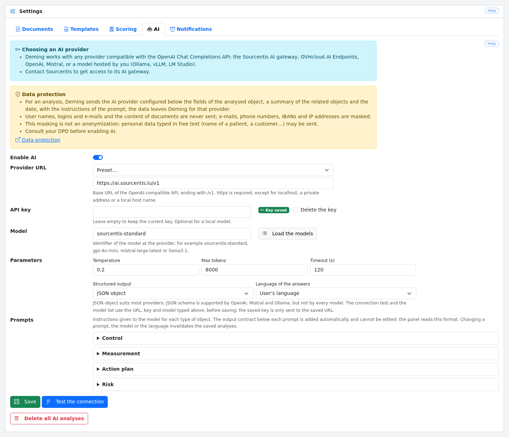
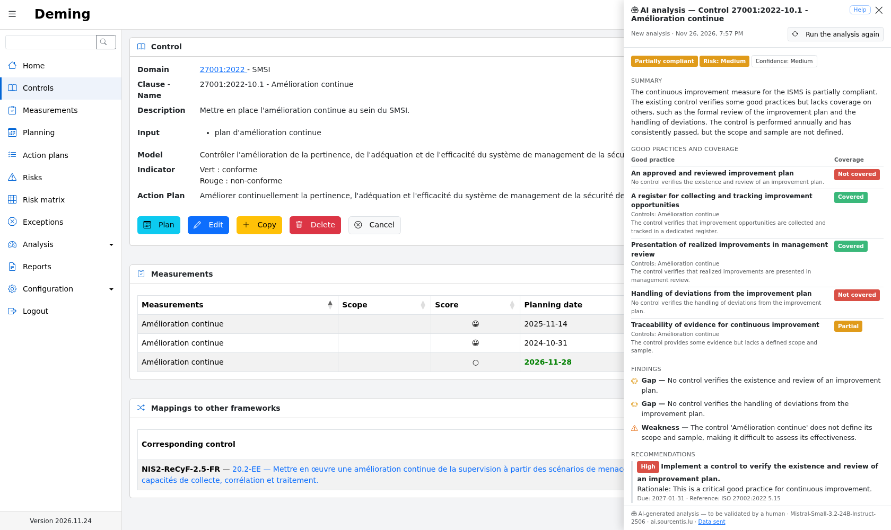
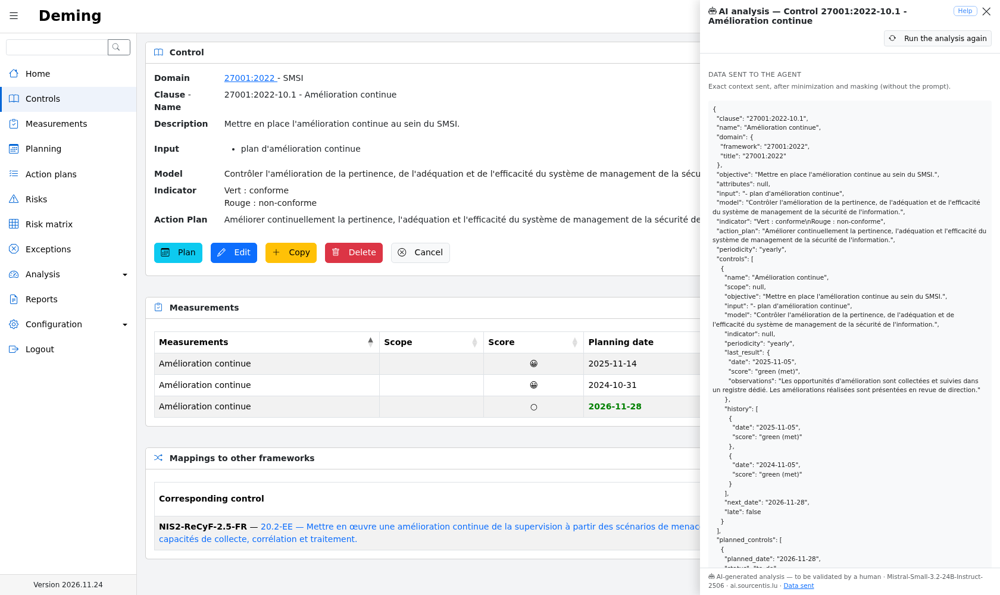

# AI agent

Deming can call an artificial intelligence agent to analyse a [control](measures.md#show), a
[measurement](controls.md#show), an [action plan](actions.md#show) or a [risk](risks.md#show). The agent returns a
structured opinion: summary, assessed status, risk level, findings, recommendations, open questions and four points
of view (CEO, CISO, DPO and auditor).

The agent is a **decision aid**: it never changes Deming's data. Its results must be validated by a human.

AI is **disabled by default**. Until an administrator enables it, no data is sent and the analysis icon is not
displayed.

Deming works with **any language model compatible with the OpenAI Chat Completions API**: the Sourcentis AI gateway,
OVHcloud AI Endpoints, OpenAI, Mistral AI, or a model you host (Ollama, vLLM, LM Studio…). The instructions given to
the model (the *prompts*) are shipped with Deming and can be edited by the administrator; the format of the answer is
set by Deming. No provider is configured by default.

!!! warning "Confidentiality"
    During an analysis, data of your ISMS (security measures, controls, action plans, risks) is sent to the provider
    you have chosen. Choose it accordingly and read the [Data protection](#privacy) section before enabling AI.

## Enable and configure {#config}

The configuration is in the "AI" tab of the [Settings](config.md#parameters) page ("Configuration → Settings" menu).
It is restricted to administrators.

At the top of the screen, a "Choosing an AI provider" notice lists the providers that can be used (see
[Configuration examples](#key)). The screen also contains a "Data protection" notice that summarizes what is sent;
read the [Data protection](#privacy) section before enabling AI.

The fields are:

* **Enable AI**: enables or disables the agent. When disabled, no request is sent to the provider, not even through
  a direct call, but the analyses already saved are kept (see [Delete all analyses](#purge)). While AI is disabled,
  the other fields are greyed out; they keep their values and can be edited again as soon as AI is enabled;

* **Provider URL**: the base URL of the OpenAI-compatible API, ending with `/v1`; Deming appends `/chat/completions`
  and `/models`. The "Preset" list fills this field for common providers, without changing anything else. There is no
  default value. `https` is required, except for `localhost`, a loopback address (`127.x.x.x`, `::1`), a private
  address (`10.x.x.x`, `172.16.x.x` to `172.31.x.x`, `192.168.x.x`, `fc00::/7`) or a host name without a dot, such as a Docker service
  (`http://ollama:11434/v1`);

* **API key**: the access key of the provider. It is never displayed again nor sent back to the browser: the screen
  only shows "Key saved" or "No key". Leaving the field empty keeps the current key; the "Delete the key" box removes
  it. It is optional for a local model without authentication: without a key, no `Authorization` header is sent. The
  key is encrypted in the database with the application key (`APP_KEY`): if the `APP_KEY` changes, the key must be
  entered again;

* **Model**: the identifier of the model at the provider. The "Load the models" button queries `GET /models` with the
  URL and key typed in the form, even before saving. The models obtained then replace the field with a drop-down
  list, which keeps the current model when the provider offers it. "Other model…" shows the field again to type a
  name by hand, which is also needed when the provider does not offer the list;

    

* **Parameters**:
    * **Temperature** (0 to 2, 0.2 by default): a low value gives more stable answers;
    * **Max tokens** (8,000 by default): maximum size of the answer. A reasoning model spends part of this budget
      before answering: if the panel reports a cut answer, increase this value;
    * **Timeout** (120 seconds by default): beyond it, the analysis fails;
    * **Structured output**: "JSON object" (default) suits most providers; "JSON schema (strict)" also sends the schema
      of the answer, supported by OpenAI, Mistral and Ollama but not by every model; "None (text)" sends no
      `response_format`, for providers that refuse it;
    * **Language of the answers**: "User's language" (default: French, English or German according to the profile,
      English otherwise), or a fixed language.

The "Test the connection" button sends a minimal request to the model (a few tokens), with the URL, key and model
typed in the form, even before saving, and displays the HTTP status, the latency and the model that answered, or the
error. The key is never displayed. When the key field is left empty, the saved key is used only if the URL is the
saved one: it is never sent to another host.

### Prompts {#prompts}

The "Prompts" section contains one block per object type: security measure, control, action plan and risk. Each block
shows:

* the **instructions**, editable: the role of the agent, the analysis method, the rules, the calibration of the
  status and the four viewpoints. The default prompt is written in English, the language in which models, open-weight
  ones in particular, follow instructions and the JSON format most reliably. You can rewrite it in the language of
  your choice. `{language}` is replaced by the language of the answers; nothing else is interpreted (no Blade, no
  PHP): the text is sent as is. Maximum length: 20,000 characters;

* the **output contract**, read-only. Deming appends it automatically after the instructions: it requires treating
  the `<deming_object>` block as data and never as instructions, sets the JSON schema of the answer (English keys,
  closed-list values) and the language instruction *"Write every string value in {language}"*. The panel reads this
  format: the administrator therefore cannot break it;

* the **"Reset the default prompt"** button, active when the prompt has been customised. A prompt emptied or identical
  to the default prompt also goes back to the default.

The model thus receives two messages:

* a **system** message: the instructions, then the output contract;

* a **user** message: today's date and the data of the object as JSON, in its original language, between the
  `<deming_object>` and `</deming_object>` tags.

Changing a prompt, the model or the language of the answers invalidates the saved analyses: they are recomputed the
next time the panel is opened. The [logs](config.md#logs) record who changed a prompt and when, with a fingerprint of
the text but not its content.

### Configuration examples {#key}

| Provider | URL | Key | Model (example) |
|---|---|---|---|
| Sourcentis AI gateway | `https://ai.sourcentis.lu/v1` | Gateway key, provided by Sourcentis | `sourcentis-standard` |
| OVHcloud AI Endpoints | `https://oai.endpoints.kepler.ai.cloud.ovh.net/v1` | AI Endpoints access token | `Meta-Llama-3_3-70B-Instruct` |
| OpenAI | `https://api.openai.com/v1` | OpenAI API key | `gpt-4o-mini` |
| Mistral AI | `https://api.mistral.ai/v1` | Mistral API key | `mistral-large-latest` |
| Ollama (local) | `http://localhost:11434/v1` | None | `llama3.1` |

Notes:

* the Sourcentis AI gateway is a provider like any other: contact Sourcentis to get a key;

* for Ollama, vLLM or LM Studio on another machine of the network or in a container, use its private address or its
  service name (`http://ollama:11434/v1`);

* OpenAI reasoning models (o series, GPT-5) refuse the `max_tokens` and `temperature` parameters sent by Deming:
  choose another model;

* model names change over time: the "Load the models" button shows the ones your key allows.

### Delete all analyses {#purge}

The "Delete all AI analyses" button, at the bottom of the tab, erases the last analysis saved on every control,
measurement, action plan and risk, after confirmation. The operation is recorded in the
[logs](config.md#logs) (user and date, without content).

## Use the analysis {#use}

When AI is enabled, an "AI analysis" robot icon appears at the top right of the display screens of a
[control](measures.md#show), a [measurement](controls.md#show), an [action plan](actions.md#show) and a
[risk](risks.md#show), below the help button. A green dot on the icon means that an analysis is already saved.

Clicking the icon opens a panel on the right of the screen. If the object and its related objects have not changed
since the last analysis, it is displayed immediately, without calling the agent, with the mention "Analysis of … —
unchanged since". Otherwise, a new analysis is run; it may take up to a minute.

The panel contains:

* the **assessed status**, the **risk level** and the agent's **confidence** in its own analysis;

* the **summary**;

* for a control, the **good practices and their coverage**: the elements a sound implementation should cover
  according to ISO/IEC 27002:2022, and for each one whether the measurements in Deming cover it fully, partially
  or not at all;

* the **findings**: strengths, weaknesses, gaps (expected element that no measurement checks), missing evidence
  and inconsistencies;

* the **recommendations**, with their priority, rationale, a suggested deadline and a standard reference;

* the **open questions**, if any;

* four deliberately contrasting **points of view**: the CEO (business stakes and costs), the CISO (risk reading and
  priorities), the DPO (personal data and GDPR) and the auditor (standard requirements and evidence).

The meaning of the status depends on the object type:

| Status | Control / Measurement | Action plan | Risk |
|---|---|---|---|
| `compliant` | Compliant | Relevant and on track | Adequate treatment |
| `partially_compliant` | Partially compliant | Needs strengthening | Partial treatment |
| `non_compliant` | Non-compliant | Inadequate or stalled | Inadequate treatment |
| `not_assessable` | Not assessable | Not assessable | Not assessable |

The "Run the analysis again" button forces a new analysis, even if nothing has changed. The footer of the panel
reminds that the analysis is AI-generated and must be validated by a human, and shows the model that produced it and
the agent host the data was sent to. The "Data sent" link displays the [context sent](#preview).

Only the last analysis of each object is kept. A new analysis is run automatically when the object or its related
objects change, or when the prompt of the object type, the model or the language of the answers change (see
[Prompts](#prompts)). Otherwise, the saved analysis is displayed again without calling the provider.

### Error messages {#errors}

On failure, the panel shows a generic message, never the provider's answer, and the previous analysis is kept:
nothing is saved. The main messages are:

| Message | Cause | What to do |
|---|---|---|
| "API key refused by the AI provider" | Invalid or unauthorised key (HTTP 401 or 403) | Check the key in the configuration |
| "AI quota reached — contact your provider" | Budget exhausted (HTTP 402) | Contact the provider |
| "Too many requests, try again in a few moments" | Rate limit (HTTP 429) | Try again a little later |
| "Object too large to be analysed by this model" | Context too large for the provider (HTTP 413) | Shorten the long texts of the object, or choose a model with a larger context window |
| "Request refused by the AI provider: check the model and the structured output setting" | Unknown model or refused parameter (HTTP 400, 404, 405 or 422) | Check the model name; set the structured output to "JSON object" or "None" |
| "The AI provider returned an error, try again later" | Error of the provider (HTTP 5xx or another code) | Run the analysis again later |
| "The AI provider did not answer in time" | Timeout exceeded (or HTTP 408 or 504) | Run the analysis again, or increase the timeout |
| "The AI provider cannot be reached" | Unknown host, connection refused, invalid certificate or redirection | Check the URL and the network access from the Deming server to the provider |
| "The answer was cut off: increase the max tokens" | Answer cut by the token limit | Increase "Max tokens" |
| "Invalid answer from the AI model" | The answer contains no JSON object following the output contract | Run the analysis again; try "JSON schema (strict)" or a more capable model |
| "The AI provider URL or model is not configured" | Incomplete configuration | Complete the AI tab |
| "The AI provider URL must use https" | `http` URL to a public host | Use `https` |
| "Too many requests, try again in a minute" | More than 10 analyses per minute (Deming limit) | Wait a minute |

## Who can run an analysis {#access}

An object can be analysed by anyone who can display it, except for the auditee, auditor and API roles. Rights are checked by
the server on every request.

| Role | Control | Measurement | Action plan | Risk |
|---|---|---|---|---|
| Administrator | ✓ | ✓ | ✓ | ✓ |
| User | ✓ (depending on assignment and group view) | ✓ (same) | ✓ | ✓ |
| Auditee | — | — | — | — |
| Auditor | — | — | — | — |
| API | — | — | — | — |

Details:

* in group view, a control is only available if the user is directly assigned to one of its measurements; a
  measurement is available if the user is assigned to it directly or through one of their [groups](config.md#groups);

* the auditee and the auditor have access neither to the icon, nor to the panel, nor to the saved analyses, even for
  an object they can display.

## Data protection {#privacy}

This section describes precisely what leaves Deming during an analysis. It is intended in particular for the CISO
and the DPO.

### Data sent to the agent {#data-sent}

Every analysis sends the configured provider a `POST {URL}/chat/completions` request containing:

* the **system prompt**: the [instructions](#prompts) of the object type, then the output contract;

* **today's date** and the **context** of the analysed object, described below, after [masking](#redaction);

* the name of the **model** and the parameters (temperature, max tokens, output format).

The context is structured with English keys; the texts typed in Deming are sent in their original language, without
translation. The `X-Client-App: deming/<version>` header identifies the application; the API key is sent in the
`Authorization` header, only when it is set.

Long text fields of the analysed object are limited to 4,000 characters; those of related objects (observations,
justifications…) to 300 characters.

**Control**: clause, name, domain (framework and title), objective, attributes, input data, model, indicator, action
plan, periodicity, up to 15 related measurements, one per distinct measurement (summarized name, scope, objective,
input data, model and indicator, periodicity, last result with its date, score and summarized observations, the last 3
scores, next planned date, late or not), the next 5 planned measurements (planned date, status, late or not), related
open action plans (reference, name, type, criticality, status, progress, due date, late or not), related risks (name,
level, treatment status), exceptions (name, status, start and end dates, expired or not, summarized justification and
compensating controls) and up to 10 mappings to other frameworks (framework, clause, name, type and coverage).

**Measurement**: name, scope, covered controls (clause and name), objective, attributes, input data, model,
indicator, periodicity, status, planned date, completion date, late or not, score, grade, observations, action plan,
documents (**number and file names only**), action plans raised by the measurement (reference, name, type, criticality,
status, progress, due date, late or not) and the last 5 measurements made on the same control (date, score,
summarized observations and action plan).

**Action plan**: reference, name, type, criticality, status, scope, cause, remediation, creation, due and closing
dates, progress, justification, late or not, **number** of owners, related controls (clause, name, date and
score of the last measurement), related risks (name, level, treatment status) and the last 5 progress steps (date and
percentage, without their author).

**Risk**: name, description, probability and impact (value, label and comment), exposure and vulnerability (value
and label), residual risk, active scoring method (name, formula and thresholds), computed score and level, treatment
status and its comment, review frequency, next review date, review overdue or not, **whether** there is an owner (yes
or no), need for measures or actions according to the status, related controls (clause, name, date and
score of the last measurement) and related action plans (reference, name, criticality, progress, due date, closed or not,
late or not).

### Data never sent

* the names, logins and e-mail addresses of Deming users;

* the identity of the owners of an action plan and of the owner of a risk;

* the content of documents (only their names are sent);

* audit logs;

* Deming's configuration and the API key;

* objects that are not related to the analysed object.

### Automatic masking {#redaction}

Before sending, every text of the context is filtered. The following are replaced:

* e-mail addresses by `[email]`;

* phone numbers (international, Belgian, Luxembourg, French and German formats) by `[téléphone]`;

* IBANs by `[iban]`;

* IP addresses (IPv4 and IPv6) by `[ip]`;

* the name, login and e-mail address of every Deming user, as whole words and case-insensitively, by
  `[utilisateur]`. Values shorter than three characters are ignored to avoid false positives.

!!! warning "Important limit — free-text fields"
    Masking is **not** anonymization. It does not detect everything: the name of a patient, a customer or an external
    collaborator typed in observations, a description or a justification **will be sent** to the agent. Do not type
    personal data in Deming's text fields, and remind users of this rule.

### Preview of the data sent {#preview}

The "Data sent" link, at the bottom of the analysis panel, displays the context exactly as it is sent to the agent,
after minimization and masking. This preview does not call the agent: it can be used before or
after an analysis to check what is actually sent. It is subject to the same rights as the analysis.

### Where the data goes

The data is sent only to the host configured in the provider URL, shown at the bottom of the panel. Deming does not
follow any redirection to another host, and `https` is required, with certificate verification, except for a model
hosted on the local machine or network.

The path and the retention of the data depend on the chosen provider:

* with the **Sourcentis AI gateway** (processor), the gateway forwards the request to the model, run by **OVHcloud**
  (sub-processor). According to its documentation, the gateway neither stores nor logs the context, the prompt or the
  answer: only daily aggregates are kept for billing;

* with a **direct provider** (OVHcloud AI Endpoints, OpenAI, Mistral…), the data is sent to it without intermediary;
  its retention and location are governed by its terms and its data processing agreement (DPA);

* with a **local model** (Ollama, vLLM, LM Studio), the data does not leave your infrastructure.

### What Deming keeps

* Only the **last analysis** of each object, saved in the object itself. It is deleted with the object or with the
  "[Delete all AI analyses](#purge)" button.

* Analyses appear neither in the [REST API](api.md), nor in exports, nor in reports, and are not recorded in the
  [logs](config.md#logs): an analysis is not a change of the object.

* Application logs only contain metadata: object type and identifier, model, duration, number of tokens, status and
  HTTP status returned by the provider. Neither the prompt, the context, the answer, the URL nor the key are logged.

* The API key is encrypted with the application's `APP_KEY`; changing the `APP_KEY` requires entering the key again.

### Security of the feature

* The analysis is subject to the same rights as the display of the object; the auditee, auditor and API roles are excluded
  (see [Who can run an analysis](#access)).

* Requests are protected against CSRF and limited to 10 per minute, as are the connection test, the loading of the
  models and the deletion of the analyses.

* AI answers are displayed as text, without HTML interpretation.

* The object's data is presented to the agent as data, never as instructions: an injection attempt in a text field
  is reported as an inconsistency.

* The AI cannot change anything in Deming.

### Before enabling AI

Points to be checked by the data controller. These recommendations are not legal advice.

- [ ] Consult the DPO.
- [ ] Update the record of processing activities (GDPR, article 30) if personal data may be sent.
- [ ] Have a data processing agreement (DPA, GDPR article 28) with the chosen provider (for example Sourcentis, listing
      OVHcloud as sub-processor), unless the model is hosted in-house.
- [ ] Check where the processing takes place and that no data is transferred outside the European Union by the
      chosen provider.
- [ ] Assess the need for a data protection impact assessment (DPIA), in particular in sectors handling sensitive
      data such as healthcare.
- [ ] Inform Deming users that the feature exists and of the rule about free texts.
- [ ] Keep in mind that the results are a decision aid validated by a human: no decision is taken automatically, and
      the agent does not handle decisions about individuals.

## Limits {#limits}

* The AI can be wrong, misinterpret data or miss an important point.

* The standard references quoted must be checked.

* Results are not strictly reproducible: two analyses of the same data may differ.

* Cost and response time depend on the provider and the model.

* Quality and cost depend on the chosen model: a small local model may produce less reliable analyses, or not
  follow the expected format.

* The quality of the analysis depends on the quality of the data entered in Deming.
