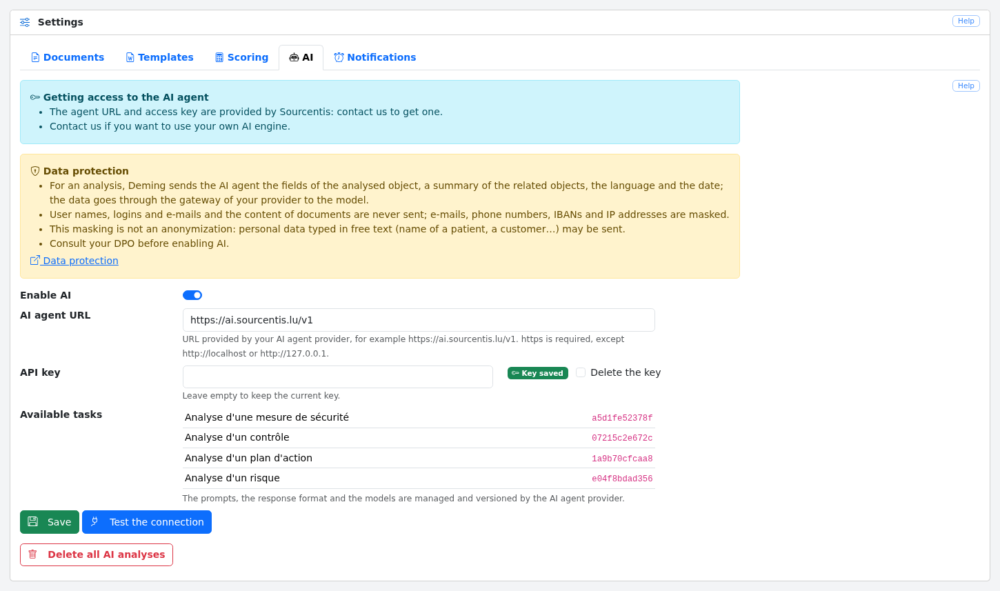
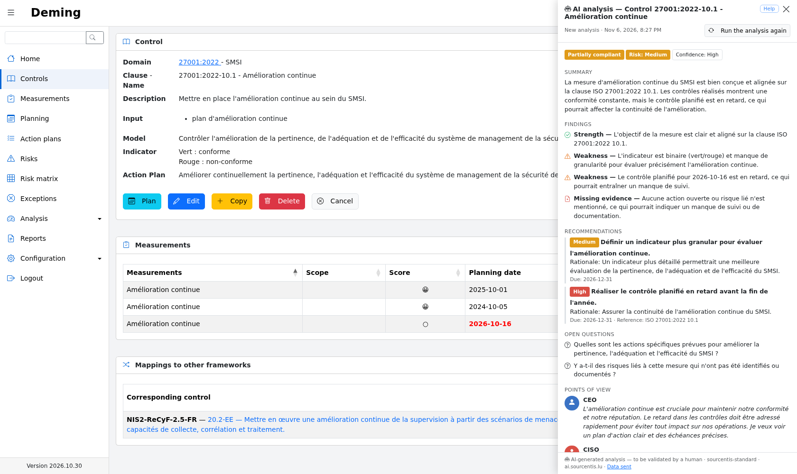
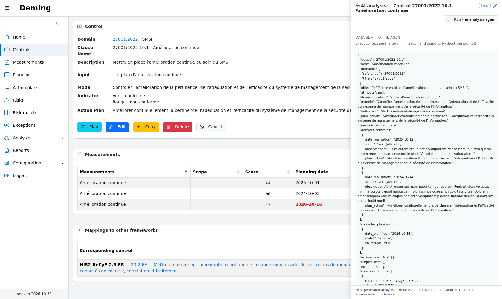

# AI agent

Deming can call an artificial intelligence agent to analyse a [control](measures.md#show), a
[measurement](controls.md#show), an [action plan](actions.md#show) or a [risk](risks.md#show). The agent returns a
structured opinion: summary, assessed status, risk level, findings, recommendations, open questions and four points
of view (CEO, CISO, DPO and auditor).

The agent is a **decision aid**: it never changes Deming's data. Its results must be validated by a human.

AI is **disabled by default**. Until an administrator enables it, no data is sent and the analysis icon is not
displayed.

The AI agent is provided by the **Sourcentis AI gateway**, a private service that holds the prompts, the response
format and the models. Deming only sends it the data of the object to analyse. The feature is therefore reserved for
Sourcentis customers: no agent is configured by default, and Deming cannot call another provider or a local model
directly. [Contact us](#key) if you want to use your own AI engine.

## Enable and configure {#config}

The configuration is in the "AI" tab of the [Settings](config.md#parameters) page ("Configuration → Settings" menu).
It is restricted to administrators.

At the top of the screen, a "Getting access to the AI agent" notice explains how to get a key or use your own AI
engine (see [Get a key](#key)). The screen also contains a "Data protection" notice that summarizes what is sent to the agent; read the
[Data protection](#privacy) section before enabling AI.

The fields are:

* **Enable AI**: enables or disables the agent. When disabled, no request is sent to the agent, but the analyses
  already saved are kept (see [Delete all analyses](#purge)). While AI is disabled, the other fields are greyed out;
  they keep their values and can be edited again as soon as AI is enabled;

* **AI agent URL**: the address provided by Sourcentis, `https://ai.sourcentis.lu/v1`. There is no default value.
  `https` is required, except `http://localhost` or `http://127.0.0.1` (development gateway);

* **API key**: the access key provided by Sourcentis. It is never displayed again: the screen only shows "Key saved"
  or "No key". Leaving the field empty keeps the current key; the "Delete the key" box removes it. The key is
  encrypted in the database with the application key (`APP_KEY`): if the `APP_KEY` changes, the key must be entered
  again.

There is no model nor prompt to set: they are managed and versioned by the agent's provider. When AI is enabled, the
screen shows, read-only, the **available tasks** of the gateway, one per object type (control, measurement, action
plan and risk), with their version. If the gateway cannot be reached or refuses the key, a message is shown instead
of the list.

The "Test the connection" button queries the task catalog of the gateway, with the saved configuration. This request
is free: it uses no token. It displays the HTTP status, the latency and the number of Deming tasks found: "4/4 Deming
tasks" means that everything is in place. The key is never displayed.

### Get a key {#key}

The URL and the key are provided by Sourcentis: contact us to get one. The key is sent only once: paste it in
Deming's "API key" field.

Contact us as well if you want to use your own AI engine instead of the Sourcentis AI gateway.

### Delete all analyses {#purge}

The "Delete all AI analyses" button, at the bottom of the tab, erases the last analysis saved on every control,
measurement, action plan and risk, after confirmation. The operation is recorded in the
[logs](config.md#logs) (user and date, without content).

## Use the analysis {#use}

When AI is enabled, an "AI analysis" robot icon appears at the top right of the display screens of a
[control](measures.md#show), a [measurement](controls.md#show), an [action plan](actions.md#show) and a
[risk](risks.md#show), below the help button. A green dot on the icon means that an analysis is already saved.

Clicking the icon opens a panel on the right of the screen. If the object and its related objects have not changed
since the last analysis, it is displayed immediately, without calling the agent, with the mention "Analysis of … —
unchanged since". Otherwise, a new analysis is run; it may take up to a minute.

The panel contains:

* the **assessed status**, the **risk level** and the agent's **confidence** in its own analysis;

* the **summary**;

* the **findings**: strengths, weaknesses, missing evidence and inconsistencies;

* the **recommendations**, with their priority, rationale, a suggested deadline and a standard reference;

* the **open questions**, if any;

* four deliberately contrasting **points of view**: the CEO (business stakes and costs), the CISO (risk reading and
  priorities), the DPO (personal data and GDPR) and the auditor (standard requirements and evidence).

The meaning of the status depends on the object type:

| Status | Control / Measurement | Action plan | Risk |
|---|---|---|---|
| `conforme` | Compliant | Relevant and on track | Adequate treatment |
| `partiellement_conforme` | Partially compliant | Needs strengthening | Partial treatment |
| `non_conforme` | Non-compliant | Inadequate or stalled | Inadequate treatment |
| `non_evaluable` | Not assessable | Not assessable | Not assessable |

The "Run the analysis again" button forces a new analysis, even if nothing has changed. The footer of the panel
reminds that the analysis is AI-generated and must be validated by a human, and shows the model that produced it and
the agent host the data was sent to. The "Data sent" link displays the [context sent](#preview).

Only the last analysis of each object is kept. A new analysis is run automatically when the object, its related
objects or the user's language change, or when the provider publishes a new version of the task (prompt, format or
model). If the gateway is temporarily unreachable, the last analysis is still displayed.

### Error messages {#errors}

On failure, the panel shows a generic message, never the gateway's answer, and the previous analysis is kept. The
main messages are:

| Message | Cause | What to do |
|---|---|---|
| "AI agent access key invalid, suspended or terminated" | The gateway refuses the key (HTTP 401) or does not allow it for this analysis (HTTP 403) | Check the key in the configuration, then contact Sourcentis |
| "Monthly AI quota reached — contact your provider" | The monthly budget of the key is exhausted (HTTP 402), until the 1st of the next month | Contact Sourcentis |
| "Too many requests, try again in a few moments" | Rate limit of the key or of the provider (HTTP 429) | Try again a little later |
| "Object too large to be analysed" | The context exceeds the size accepted by the gateway (HTTP 413) | Shorten the long texts of the object |
| "AI agent incompatible with this version of Deming" | Request refused or unknown task (HTTP 400 or 404) | Update Deming, or contact Sourcentis |
| "Invalid answer from the AI agent" / "The AI agent did not answer in time" | Invalid model answer (HTTP 502) or timeout (HTTP 504) | Run the analysis again |

## Who can run an analysis {#access}

An object can be analysed by anyone who can display it, except for the auditor and API roles. Rights are checked by
the server on every request.

| Role | Control | Measurement | Action plan | Risk |
|---|---|---|---|---|
| Administrator | ✓ | ✓ | ✓ | ✓ |
| User | ✓ (depending on assignment and group view) | ✓ (same) | ✓ | ✓ |
| Auditee | ✓ if assigned | ✓ if assigned | — | ✓ (all risks) |
| Auditor | — | — | — | — |
| API | — | — | — | — |

Details:

* in group view, a control is only available if the user is directly assigned to one of its measurements; a
  measurement is available if the user is assigned to it directly or through one of their [groups](config.md#groups);

* the auditee has no access to action plans, nor to their analysis;

* the auditee can display, and therefore analyse, all risks;

* the auditor has access neither to the icon, nor to the panel, nor to the saved analyses, even for an object they
  can display.

## Data protection {#privacy}

This section describes precisely what leaves Deming during an analysis. It is intended in particular for the CISO
and the DPO.

### Data sent to the agent

Every analysis sends the gateway, on the task of the object type:

* the **context** of the analysed object, described below, after [masking](#redaction);

* the user's **language** (`fr`, `en` or `de`);

* **today's date**.

Nothing else is sent: no prompt, no response format, no model name. The prompt and the format are added by the
gateway.

Long text fields of the analysed object are limited to 4,000 characters; those of related objects (observations,
justifications…) to 300 characters.

**Control**: clause, name, domain (framework and title), objective, attributes, input data, model,
indicator, action plan, periodicity, the last 5 measurements made (date, score, summarized observations and action plan),
the next 5 planned measurements (planned date, status, late or not), related open action plans (reference, name, type,
criticality, status, progress, due date, late or not), related risks (name, level, treatment status), exceptions
(name, status, start and end dates, expired or not, summarized justification and compensating controls) and up to 10
mappings to other frameworks (framework, clause, name, type and coverage).

**Measurement**: name, scope, covered controls (clause and name), objective, attributes, input data, model,
indicator, periodicity, status, planned date, completion date, late or not, score, grade, observations, action plan,
documents (**number and file names only**), action plans raised by the measurement (reference, name, type, criticality,
status, progress, due date, late or not) and the last 5 measurements made on the same control (date, score,
summarized observations and action plan).

**Action plan**: reference, name, type, criticality, status, scope, cause, remediation, creation, due and closing
dates, progress, justification, late or not, **number** of owners, related controls (clause, name, date and
score of the last measurement), related risks (name, level, treatment status) and the last 5 progress steps (date and
percentage, without their author).

**Risk**: name, description, probability and impact (value, label and comment), exposure and vulnerability (value
and label), residual risk, active scoring method (name, formula and thresholds), computed score and level, treatment
status and its comment, review frequency, next review date, review overdue or not, **whether** there is an owner (yes
or no), need for measures or actions according to the status, related controls (clause, name, date and
score of the last measurement) and related action plans (reference, name, criticality, progress, due date, closed or not,
late or not).

### Data never sent

* the names, logins and e-mail addresses of Deming users;

* the identity of the owners of an action plan and of the owner of a risk;

* the content of documents (only their names are sent);

* audit logs;

* Deming's configuration and the API key;

* objects that are not related to the analysed object.

### Automatic masking {#redaction}

Before sending, every text of the context is filtered. The following are replaced:

* e-mail addresses by `[email]`;

* phone numbers (international, Belgian, Luxembourg, French and German formats) by `[téléphone]`;

* IBANs by `[iban]`;

* IP addresses (IPv4 and IPv6) by `[ip]`;

* the name, login and e-mail address of every Deming user, as whole words and case-insensitively, by
  `[utilisateur]`. Values shorter than three characters are ignored to avoid false positives.

!!! warning "Important limit — free-text fields"
    Masking is **not** anonymization. It does not detect everything: the name of a patient, a customer or an external
    collaborator typed in observations, a description or a justification **will be sent** to the agent. Do not type
    personal data in Deming's text fields, and remind users of this rule.

### Preview of the data sent {#preview}

The "Data sent" link, at the bottom of the analysis panel, displays the context exactly as it is sent to the agent,
after minimization and masking. This preview does not call the agent: it can be used before or
after an analysis to check what is actually sent. It is subject to the same rights as the analysis.

### Where the data goes

The data is sent only to the host configured in the agent URL, shown at the bottom of the panel. Deming does not
follow any redirection to another host, and `https` is required, with certificate verification, except for a
development gateway on `localhost`.

The data travels as follows:

1. **Deming** minimizes and masks the context, before anything is sent;
2. the **Sourcentis AI gateway** (processor) adds the prompt and the response format, then forwards the request to
   the model;
3. **OVHcloud** (sub-processor) runs the model.

According to its documentation, the gateway neither stores nor logs the context, the prompt or the answer: only daily
aggregates are kept for billing (customer, model, number of tokens, cost and date). The retention of data at OVHcloud
is governed by its terms and its data processing agreement (DPA).

### What Deming keeps

* Only the **last analysis** of each object, saved in the object itself. It is deleted with the object or with the
  "[Delete all AI analyses](#purge)" button.

* Analyses appear neither in the [REST API](api.md), nor in exports, nor in reports, and are not recorded in the
  [logs](config.md#logs): an analysis is not a change of the object.

* Application logs only contain metadata: object type and identifier, model, task version, duration, number of
  tokens and status. Neither the context, nor the answer, nor the key are logged.

* The API key is encrypted with the application's `APP_KEY`; changing the `APP_KEY` requires entering the key again.

### Security of the feature

* The analysis is subject to the same rights as the display of the object; the auditor and API roles are excluded
  (see [Who can run an analysis](#access)).

* Requests are protected against CSRF and limited to 10 per minute.

* AI answers are displayed as text, without HTML interpretation.

* The object's data is presented to the agent as data, never as instructions: an injection attempt in a text field
  is reported as an inconsistency.

* The AI cannot change anything in Deming.

### Before enabling AI

Points to be checked by the data controller. These recommendations are not legal advice.

- [ ] Consult the DPO.
- [ ] Update the record of processing activities (GDPR, article 30) if personal data may be sent.
- [ ] Have a data processing agreement (DPA, GDPR article 28) with Sourcentis, listing OVHcloud as sub-processor.
- [ ] Check where the processing takes place and that there is no transfer outside the European Union, including at
      OVHcloud.
- [ ] Assess the need for a data protection impact assessment (DPIA), in particular in sectors handling sensitive
      data such as healthcare.
- [ ] Inform Deming users that the feature exists and of the rule about free texts.
- [ ] Keep in mind that the results are a decision aid validated by a human: no decision is taken automatically, and
      the agent does not handle decisions about individuals.

## Limits {#limits}

* The AI can be wrong, misinterpret data or miss an important point.

* The standard references quoted must be checked.

* Results are not strictly reproducible: two analyses of the same data may differ.

* Cost and response time depend on the provider and the model.

* The feature requires a subscription to the Sourcentis AI gateway.

* The quality of the analysis depends on the quality of the data entered in Deming.
