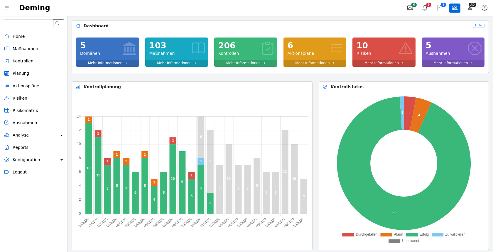
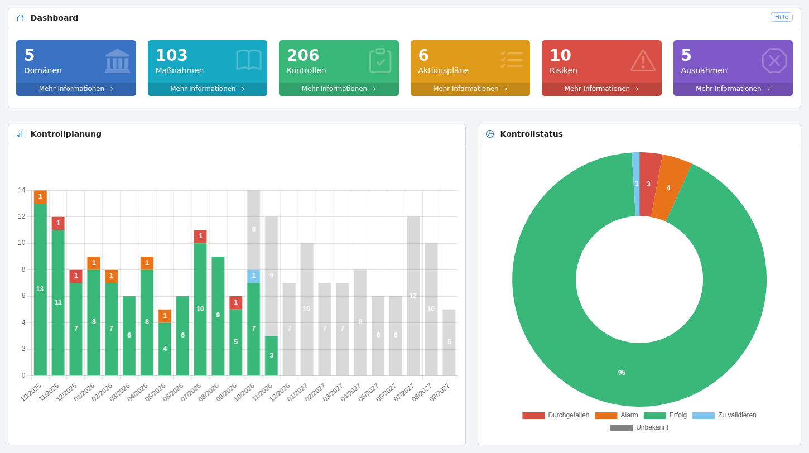

# Anwendung

## Hauptseite {#main}

Die Hauptseite der Anwendung gibt einen Überblick über das ISMS und die durchzuführenden Kontrollen.

Die Ansicht besteht aus:

* links dem Hauptmenü der Anwendung mit einem Suchfeld oben. Das Menü kann mit der Schaltfläche ☰
  eingeklappt werden und wird auf Smartphones und Tablets als Schublade angezeigt;

* oben einer Werkzeugleiste mit schnellem Zugriff auf:
    * die in diesem Monat geplanten Kontrollen (Umschlag),
    * die verspäteten Kontrollen (Glocke),
    * die offenen Aktionspläne (Fahne),
    * den Wechsel zwischen „Meine Daten“ und „Alle Daten“ (Gruppensymbol, nur für Administratoren und Benutzer),
    * das Benutzerprofil,
    * die Online-Hilfe.

Jede Ansicht verfügt außerdem über eine Schaltfläche „Hilfe“ oben rechts in ihrem ersten Rahmen, die die Seite dieser
Dokumentation öffnet, die die Ansicht beschreibt, in der Sprache des Benutzers (auf Englisch für Sprachen ohne
übersetzte Dokumentation).

Das Dashboard zeigt oben Indikatoren zu:

* der Anzahl der Sicherheitsdomänen
* der Anzahl der ausgewählten Sicherheitsmaßnahmen
* der Anzahl der Kontrollen
* der Anzahl der offenen Aktionspläne
* der Anzahl der Risiken
* der Anzahl der Ausnahmen

Jeder Indikator verfügt über einen Link „Mehr Informationen“, der die entsprechende Liste öffnet.

Hinweis:

* Hat eine Domäne keine Sicherheitsmaßnahme oder ist keine der Sicherheitsmaßnahmen dieser Domäne geplant, wird die Domäne nicht berücksichtigt.
* Ist eine Sicherheitsmaßnahme nicht geplant, wird sie bei der Zählung nicht berücksichtigt.
* Ist ein Aktionsplan abgeschlossen, wird er nicht berücksichtigt.

In der Mitte:

* Der Zeitplan der Kontrollen, der die durchgeführten Kontrollen mit ihrem Ergebnis (grün, orange oder rot), die durchgeführten Kontrollen, die auf ihre Validierung warten (hellblau), und die geplanten Kontrollen (grau) zeigt
* Ein Gesamtstatus der Kontrollen. Für Administratoren und Benutzer, die Kontrollen validieren können, zeigt er auch die Kontrollen, die auf ihre Validierung warten (hellblau)

Der untere Teil der Hauptseite enthält die Liste der in den nächsten 30 Tagen geplanten Kontrollen:

Überschrittene Planungsdaten werden rot angezeigt.

## Suche {#search}

Mit dem Suchfeld oben im Menü kann ein Wort in den Domänen, den Sicherheitsmaßnahmen, den Kontrollen (Name, Ziele, Beobachtungen) und ihren Aktionsplänen gesucht werden.

