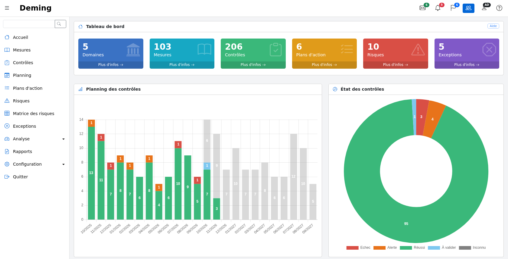
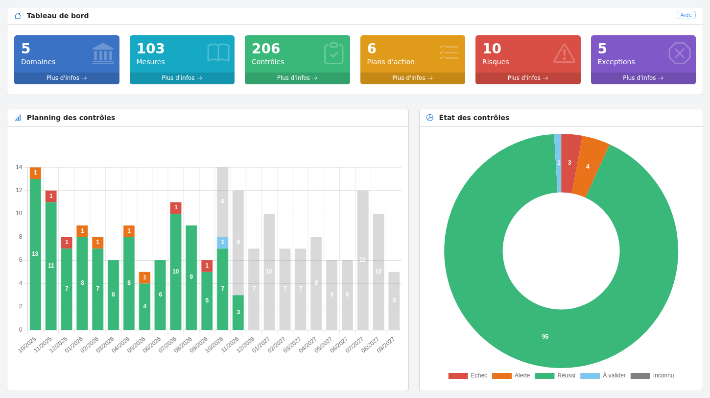

# Application

## Page principale {#main}

La page principale de l’application permet d'avoir une vue d'ensemble du SMSI et des contrôles à réaliser.

L'écran est composé :

* sur la gauche, du menu principal de l’application, avec un champ de recherche en haut. Le menu peut être replié
  avec le bouton ☰ et s'affiche sous forme de tiroir sur téléphone et tablette ;

* en haut, d'une barre d'outils donnant un accès rapide :
    * aux contrôles planifiés ce mois-ci (enveloppe),
    * aux contrôles en retard (cloche),
    * aux plans d'action ouverts (drapeau),
    * à la bascule entre « mes données » et « toutes les données » (icône groupe, administrateurs et utilisateurs uniquement),
    * au profil de l'utilisateur,
    * à l'aide en ligne.

Chaque écran dispose également d'un bouton « Aide », en haut à droite de son premier cadre, qui ouvre la page de
cette documentation décrivant l'écran, dans la langue de l'utilisateur (en anglais pour les langues sans documentation traduite).

Le tableau de bord affiche en haut des indicateurs sur :

* le nombre de domaines de sécurité
* le nombre de mesures de sécurité sélectionnées
* le nombre de contrôles
* le nombre de plans d’action ouverts
* le nombre de risques
* le nombre d'exceptions

Chaque indicateur dispose d'un lien « Plus d'infos » qui ouvre la liste correspondante.

Note :

* si un domaine n'a aucune mesure de sécurité ou qu'aucune des mesures de sécurité de ce domaine n'est planifiée alors le domaine n'est pas pris en compte.
* si une mesure de sécurité n'est pas planifiée, elle n'est pas prise en compte dans le comptage.
* si un plan d'action est terminé il n'est pas pris en compte.

Au milieu :

* Le planning des contrôles qui montre les contrôles réalisés avec leur résultat (vert, orange ou rouge), les contrôles réalisés en attente de validation (en bleu clair) et les contrôles planifiés (en gris)
* Un état global des contrôles. Pour les administrateurs et les utilisateurs, qui peuvent valider les contrôles, il affiche aussi les contrôles en attente de validation (en bleu clair)

La partie inférieure de la page principale contient la liste des contrôles planifiés dans les 30 prochains jours :

Les dates de planification dépassées sont affichées en rouge.

## Recherche {#search}

Le champ de recherche en haut du menu permet de trouver un mot dans les domaines, les mesures de sécurité, les contrôles (nom, objectifs, observations) et leurs plans d’action.

