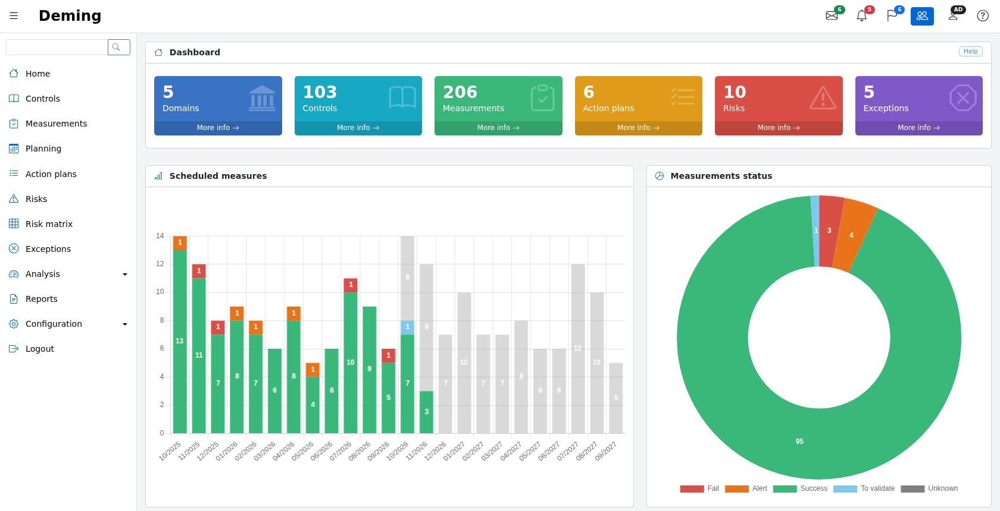
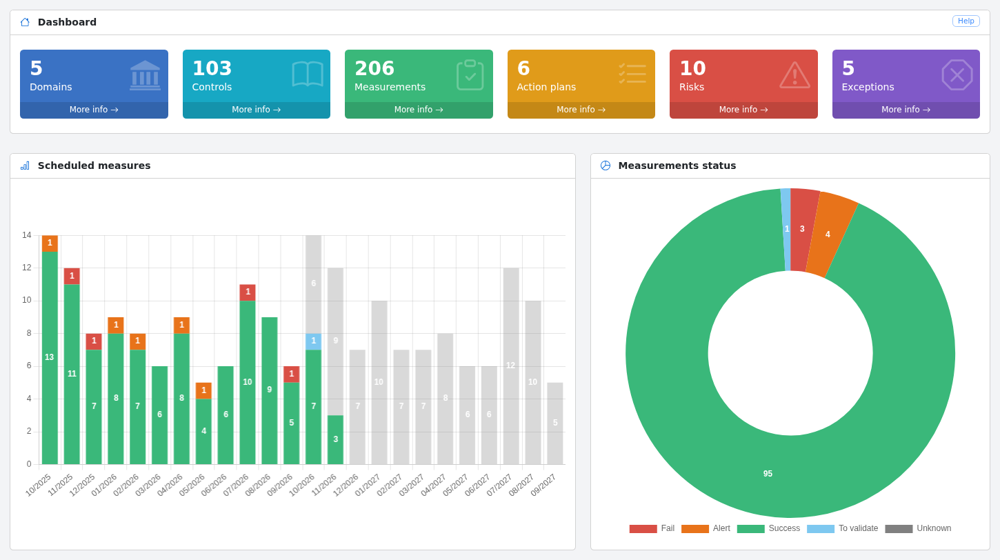

# Application

## Main page {#main}

The main page of the application provides an overview of the ISMS and the checks to be carried out.

The screen is composed of:

* on the left, the application's main menu, with a search field at the top. The menu can be collapsed with the
  ☰ button and is displayed as a drawer on phones and tablets;

* at the top, a toolbar giving quick access to:
    * the measurements planned this month (envelope),
    * the late measurements (bell),
    * the open action plans (flag),
    * the switch between "my data" and "all data" (group icon, administrators and users only),
    * the user profile,
    * the online help.

Each screen also has a "Help" button, at the top right of its first panel, which opens the page of this
documentation describing the screen, in the user's language (in English for languages without a translated documentation).

The dashboard displays, at the top, indicators on:

* the number of security domains
* the number of selected controls
* the number of measurements
* the number of open action plans
* the number of risks
* the number of exceptions

Each indicator has a "More info" link that opens the corresponding list.

Note:

* if a domain has no controls, or none of the domain's controls are planned, then the domain is not taken into account.
* if a control is not planned, it is not included in the count.
* if an action plan has been completed, it is not taken into account.

In the middle:

* The measurement schedule, which shows the measurements carried out with their result (green, orange or red), the measurements carried out and awaiting validation (light blue) and the planned measurements (in grey)
* An overall status of the measurements. For administrators and users, who can validate measurements, it also shows the measurements awaiting validation (light blue)

The lower part of the main page contains the list of measurements scheduled for the next 30 days:

Overdue planning dates are displayed in red.

## Search {#search}

The search field at the top of the menu allows you to search for a word in the domains, the controls,
the measurements (name, objectives, observations) and their action plans.

